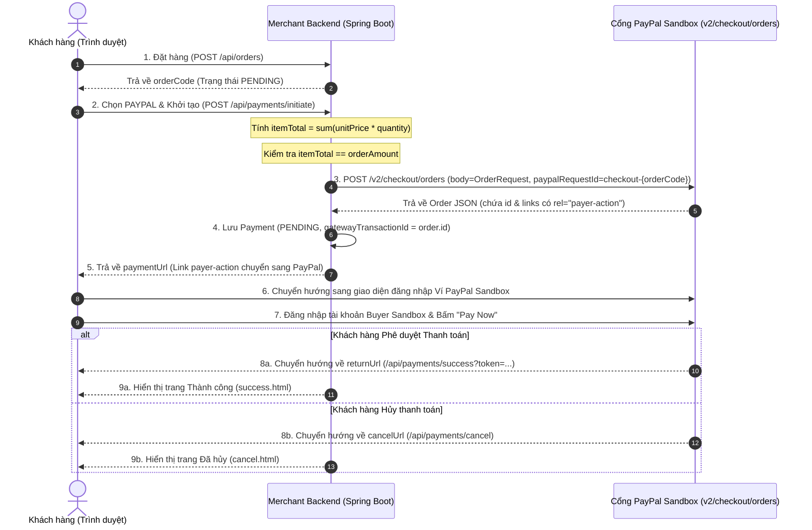

# 🅿️ Hướng Dẫn Tích Hợp Cổng Thanh Toán PayPal (PayPal Gateway for Java & Spring Boot)

Tài liệu hướng dẫn chi tiết toàn bộ quy trình tích hợp cổng thanh toán trực tuyến toàn cầu **PayPal** (sử dụng thư viện chính thức **PayPal Server SDK v2.4.0** - Orders API v2) vào ứng dụng **Java Spring Boot**, áp dụng mô hình thiết kế chuẩn **Strategy Pattern + Factory Pattern**. Hỗ trợ thanh toán qua Ví PayPal (PayPal Wallet), Thẻ thanh toán quốc tế và quy trình chuyển hướng phê duyệt (Buyer Approval Redirect Flow).

---

## 📌 Mục Lục
1. [Tài liệu chính thức & Tài nguyên PayPal](#1-tai-lieu-chinh-thuc-tai-nguyen-paypal)
2. [Kiến trúc & Luồng hoạt động (Sequence Diagram)](#2-kien-truc-luong-hoat-dong-sequence-diagram)
3. [Môi trường Sandbox & Tài khoản kiểm thử (Test Accounts)](#3-moi-truong-sandbox-tai-khoan-kiem-thu-test-accounts)
4. [Cấu hình tham số Spring Boot (application.yaml & pom.xml)](#4-cau-hinh-tham-so-spring-boot-applicationyaml-pomxml)
5. [Cấu trúc mã nguồn & Triển khai chi tiết (Strategy Pattern)](#5-cau-truc-ma-nguon-trien-khai-chi-tiet-strategy-pattern)
   * [5.1. Cấu hình PaypalServerSdkClient Bean (PaypalClientConfiguration)](#51-cau-hinh-paypalserversdkclient-bean-paypalclientconfiguration)
   * [5.2. Khế ước chung (PaymentStrategy & PaymentGatewayCommand)](#52-khe-uoc-chung-paymentstrategy-paymentgatewaycommand)
   * [5.3. Chiến lược thanh toán PayPal (PaypalPaymentStrategy)](#53-chien-luoc-thanh-toan-paypal-paypalpaymentstrategy)
   * [5.4. Nhà máy khởi tạo (PaymentStrategyFactory)](#54-nha-may-khoi-tao-paymentstrategyfactory)
   * [5.5. Tầng nghiệp vụ thanh toán (PaymentService)](#55-tang-nghiep-vu-thanh-toan-paymentservice)
   * [5.6. Lớp API tiếp nhận (PaymentController)](#56-lop-api-tiep-nhan-paymentcontroller)
   * [5.7. Xử lý Return / Cancel URL (ViewController)](#57-xu-ly-return-cancel-url-viewcontroller)
6. [Quy chuẩn xử lý & Các lỗi thường gặp (Lưu ý sống còn)](#6-quy-chuan-xu-ly-cac-loi-thuong-gap-luu-y-song-con)
   * [6.1. Lỗi lệch số tiền (Payment amount mismatch)](#61-loi-lech-so-tien-payment-amount-mismatch)
   * [6.2. Lỗi vượt hạn mức (TRANSACTION_LIMIT_EXCEEDED - 422)](#62-loi-vuot-han-muc-transaction-limit-exceeded-422)
   * [6.3. Giới hạn tiền tệ của PayPal (Không hỗ trợ VND)](#63-gioi-han-tien-te-cua-paypal-khong-ho-tro-vnd)
7. [Hướng dẫn kiểm thử thực tế (Testing & API Requests)](#7-huong-dan-kiem-thu-thuc-te-testing-api-requests)

---

<a id="1-tai-lieu-chinh-thuc-tai-nguyen-paypal"></a>
## 1. 📚 Tài liệu chính thức & Tài nguyên PayPal

* **Trang chủ tài liệu tích hợp PayPal Developer:** [https://developer.paypal.com/docs](https://developer.paypal.com/docs)
* **Tài liệu Orders v2 API:** [PayPal Orders v2 API Reference](https://developer.paypal.com/docs/api/orders/v2/)
* **Kho lưu trữ chính thức PayPal Server SDK Java (GitHub):** [paypal/paypal-server-sdk-java](https://github.com/paypal/paypal-server-sdk-java)
* **Quản lý Ứng dụng & Credentials Sandbox:** [PayPal Developer Dashboard](https://developer.paypal.com/dashboard/applications/sandbox)
* **Danh sách tiền tệ PayPal hỗ trợ:** [PayPal Supported Currencies](https://developer.paypal.com/api/rest/reference/currency-codes/)
* **Bảng mã lỗi chi tiết của Orders API v2:** [PayPal Error Messages - Orders v2](https://developer.paypal.com/api/rest/reference/orders/v2/errors/)

---

<a id="2-kien-truc-luong-hoat-dong-sequence-diagram"></a>
## 2. 🏗️ Kiến trúc & Luồng hoạt động (Sequence Diagram)

Mô hình thanh toán PayPal Orders API v2 với `intent=CAPTURE` theo quy trình chuẩn **Redirect Flow**:



---

<a id="3-moi-truong-sandbox-tai-khoan-kiem-thu-test-accounts"></a>
## 3. 🧪 Môi trường Sandbox & Tài khoản kiểm thử (Test Accounts)

### 3.1. Lấy Client ID và Client Secret
1. Đăng nhập vào [PayPal Developer Dashboard](https://developer.paypal.com/dashboard/).
2. Vào menu **Apps & Credentials** ➜ Chọn tab **Sandbox**.
3. Chọn ứng dụng mặc định (**Default Application**) hoặc tạo App mới:
   * **Client ID:** Sao chép chuỗi mã định danh client.
   * **Secret:** Nhấn *Show* và sao chép khóa bí mật client.

### 3.2. Tài khoản người mua Sandbox (Sandbox Buyer Account)
1. Vào menu **Testing Tools** ➜ **Sandbox Accounts**.
2. Tìm tài khoản loại **Personal** (Buyer):
   * **Email:** Dạng `sb-xxxxxx@personal.example.com`.
   * **Password:** Nhấn vào tài khoản ➜ Chọn *View/Edit account* để xem mật khẩu.
3. Số dư mặc định của tài khoản Sandbox: Thường là **$5,000 USD** (có thể nạp thêm tiền trong phần quản trị Sandbox).

---

<a id="4-cau-hinh-tham-so-spring-boot-applicationyaml-pomxml"></a>
## 4. ⚙️ Cấu hình tham số Spring Boot (application.yaml & pom.xml)

### 4.1. Thư viện phụ thuộc `pom.xml`
Dự án sử dụng thư viện chính thức mới nhất của PayPal Server SDK:

```xml
<dependency>
    <groupId>com.paypal.sdk</groupId>
    <artifactId>paypal-server-sdk</artifactId>
    <version>2.4.0</version>
</dependency>
```

### 4.2. Cấu hình kết nối trong `src/main/resources/application.yaml`
```yaml
paypal:
  client-id: ${PAYPAL_CLIENT_ID:YOUR_SANDBOX_CLIENT_ID}
  client-secret: ${PAYPAL_CLIENT_SECRET:YOUR_SANDBOX_CLIENT_SECRET}
  return-url: ${PAYPAL_RETURN_URL:http://localhost:8080/api/payments/success}
  cancel-url: ${PAYPAL_CANCEL_URL:http://localhost:8080/api/payments/cancel}
```

* `paypal.client-id`: Mã Client ID tài khoản Sandbox từ Developer Dashboard.
* `paypal.client-secret`: Mã bí mật Client Secret.
* `paypal.return-url`: URL nhận chuyển hướng khi người mua bấm xác nhận thanh toán trên PayPal.
* `paypal.cancel-url`: URL nhận chuyển hướng khi người mua bấm huỷ thanh toán trên PayPal.

---

<a id="5-cau-truc-ma-nguon-trien-khai-chi-tiet-strategy-pattern"></a>
## 5. 💻 Cấu trúc mã nguồn & Triển khai chi tiết (Strategy Pattern)

Toàn bộ logic được chuẩn hóa theo mô hình **Strategy Pattern**. Code được chú thích rõ ràng bên trong và giải thích chi tiết ngay bên dưới từng lớp.

<a id="51-cau-hinh-paypalserversdkclient-bean-paypalclientconfiguration"></a>
### 5.1. Cấu hình PaypalServerSdkClient Bean (`PaypalClientConfiguration.java`)

```java
package com.javabuilder.stripe.configuration;

import com.paypal.sdk.Environment;
import com.paypal.sdk.PaypalServerSdkClient;
import com.paypal.sdk.authentication.ClientCredentialsAuthModel;
import org.slf4j.event.Level;
import org.springframework.beans.factory.annotation.Value;
import org.springframework.context.annotation.Bean;
import org.springframework.context.annotation.Configuration;

@Configuration
public class PaypalClientConfiguration {

    // 1. Tiêm Client ID từ file cấu hình application.yaml
    @Value("${paypal.client-id}")
    private String clientId;

    // 2. Tiêm Client Secret từ file cấu hình application.yaml
    @Value("${paypal.client-secret}")
    private String clientSecret;

    @Bean
    PaypalServerSdkClient paypalServerSdkClient() {
        return new PaypalServerSdkClient.Builder()
                // 3. Cấu hình logging HTTP request/response để debug trong quá trình tích hợp
                .loggingConfig(builder -> builder
                        .level(Level.INFO)
                        .requestConfig(logConfigBuilder -> logConfigBuilder.body(true))
                        .responseConfig(logConfigBuilder -> logConfigBuilder.body(true)))
                // 4. Cài đặt timeout kết nối mạng (30 giây)
                .httpClientConfig(configBuilder -> configBuilder.timeout(30))
                // 5. Xác thực tự động bằng cơ chế OAuth2 Client Credentials
                .clientCredentialsAuth(new ClientCredentialsAuthModel.Builder(
                        clientId,
                        clientSecret
                ).build())
                // 6. Trỏ môi trường sang SANDBOX (khi lên production đổi thành Environment.PRODUCTION)
                .environment(Environment.SANDBOX)
                .build();
    }
}
```

#### 🔍 Giải thích chi tiết các hàm và thành phần PayPal Server SDK:
* **`PaypalServerSdkClient`**: Đối tượng Client chính thức của PayPal Server SDK (thay thế cho SDK REST cũ đã deprecated). Quản lý kết nối, tự động xin OAuth2 Bearer Token và điều phối các Controller con (như `OrdersController`).
* **`ClientCredentialsAuthModel.Builder(clientId, clientSecret)`**: Đóng gói thông tin xác thực OAuth2 của PayPal. SDK sẽ tự động gửi request `POST /v1/oauth2/token` với `grant_type=client_credentials` để lấy Access Token và tự động refresh token trong suốt vòng đời ứng dụng.
* **`environment(Environment.SANDBOX)`**: Định tuyến tất cả các lời gọi API tới máy chủ thử nghiệm PayPal Sandbox (`https://api-m.sandbox.paypal.com`). Khi triển khai môi trường thật chỉ cần đổi sang `Environment.PRODUCTION` (`https://api-m.paypal.com`).
* **`loggingConfig`**: Bật cơ chế ghi log chi tiết nội dung Body của Request và Response HTTP của PayPal SDK ra Console để theo dõi trực quan quá trình giao tiếp.

---

<a id="52-khe-uoc-chung-paymentstrategy-paymentgatewaycommand"></a>
### 5.2. Khế ước chung (`PaymentStrategy.java` & `PaymentGatewayCommand.java`)

#### Giao diện chiến lược:
```java
package com.javabuilder.stripe.strategy;

import com.javabuilder.stripe.common.PaymentGateway;
import com.javabuilder.stripe.dto.response.PaymentGatewayResponse;
import com.javabuilder.stripe.strategy.dto.PaymentGatewayCommand;

public interface PaymentStrategy {
    // Trả về định danh cổng thanh toán của chiến lược
    PaymentGateway getPaymentGateway();

    // Xử lý khởi tạo phiên thanh toán và trả về link thanh toán
    PaymentGatewayResponse processPayment(PaymentGatewayCommand command);
}
```

#### Dữ liệu đầu vào chuẩn hóa (DTO Command):
```java
package com.javabuilder.stripe.strategy.dto;

import com.javabuilder.stripe.common.Currency;
import lombok.Builder;

import java.math.BigDecimal;
import java.util.List;

@Builder
public record PaymentGatewayCommand(
        String orderCode,          // Mã đơn hàng định danh (ví dụ ORD-XXXXXXXX)
        BigDecimal totalPrice,     // Tổng giá trị đơn hàng
        Currency currency,         // Loại tiền tệ thanh toán (USD, VND)
        String clientIp,           // Địa chỉ IP của khách hàng
        List<LineItem> lineItems   // Danh sách chi tiết các mặt hàng trong đơn
) {

    @Builder
    public record LineItem (
            String name,           // Tên sản phẩm
            Integer quantity,      // Số lượng mua
            BigDecimal unitPrice   // Đơn giá của 1 sản phẩm
    ) {}
}
```

---

<a id="53-chien-luoc-thanh-toan-paypal-paypalpaymentstrategy"></a>
### 5.3. Chiến lược thanh toán PayPal (`PaypalPaymentStrategy.java`)

```java
package com.javabuilder.stripe.strategy.paypal;

import com.javabuilder.stripe.common.Currency;
import com.javabuilder.stripe.common.PaymentGateway;
import com.javabuilder.stripe.dto.response.PaymentGatewayResponse;
import com.javabuilder.stripe.exception.AppException;
import com.javabuilder.stripe.exception.ErrorCode;
import com.javabuilder.stripe.strategy.PaymentStrategy;
import com.javabuilder.stripe.strategy.dto.PaymentGatewayCommand;
import com.paypal.sdk.PaypalServerSdkClient;
import com.paypal.sdk.exceptions.ApiException;
import com.paypal.sdk.models.*;
import lombok.RequiredArgsConstructor;
import lombok.extern.slf4j.Slf4j;
import org.springframework.beans.factory.annotation.Value;
import org.springframework.stereotype.Component;

import java.io.IOException;
import java.math.BigDecimal;
import java.math.RoundingMode;
import java.util.ArrayList;
import java.util.List;

@Component
@RequiredArgsConstructor
@Slf4j(topic = "PAYPAL-PAYMENT-STRATEGY")
public class PaypalPaymentStrategy implements PaymentStrategy {

    // 1. URL điều hướng người mua quay lại website khi thanh toán thành công
    @Value("${paypal.return-url}")
    private String returnUrl;

    // 2. URL điều hướng người mua quay lại website khi bấm hủy thanh toán
    @Value("${paypal.cancel-url}")
    private String cancelUrl;

    // 3. Tiêm PaypalServerSdkClient đã được cấu hình từ Spring context
    private final PaypalServerSdkClient paypalServerSdkClient;

    @Override
    public PaymentGateway getPaymentGateway() {
        return PaymentGateway.PAYPAL;
    }

    @Override
    public PaymentGatewayResponse processPayment(PaymentGatewayCommand command) {
        Currency currency = command.currency();
        String code = currency.name();

        List<ItemRequest> items = new ArrayList<>();
        BigDecimal itemTotal = BigDecimal.ZERO;

        // 4. Duyệt danh sách mặt hàng, tính đơn giá và cộng dồn tổng tiền hàng
        for (PaymentGatewayCommand.LineItem itemLine : command.lineItems()) {
            // Đơn giá cho 1 sản phẩm, làm tròn 2 chữ số thập phân
            BigDecimal unitPrice = itemLine.unitPrice().setScale(2, RoundingMode.HALF_UP);
            
            // Tổng tiền cho dòng sản phẩm = đơn giá * số lượng
            BigDecimal lineTotal = unitPrice.multiply(BigDecimal.valueOf(itemLine.quantity())).setScale(2, RoundingMode.HALF_UP);
            
            // BẮT BUỘC: Cộng dồn tiền mặt hàng vào itemTotal
            itemTotal = itemTotal.add(lineTotal);

            // Tạo đối tượng ItemRequest gửi sang PayPal (unit_amount là đơn giá của 1 sản phẩm)
            ItemRequest item = new ItemRequest.Builder(
                    itemLine.name(),
                    new Money(code, unitPrice.toPlainString()),
                    itemLine.quantity().toString()
            ).build();
            items.add(item);
        }

        // 5. Chuẩn hóa chuỗi số tiền 2 chữ số thập phân để so sánh đối soát
        String itemTotalValue = itemTotal.setScale(2, RoundingMode.HALF_UP).toPlainString();
        String orderAmountValue = command.totalPrice().setScale(2, RoundingMode.HALF_UP).toPlainString();

        // 6. Kiểm tra an toàn: Tổng tiền các item phải bằng tổng tiền đơn hàng
        if (!itemTotalValue.equals(orderAmountValue)) {
            log.error("Payment amount mismatch: calculated itemTotal={}, command totalPrice={}", itemTotalValue, orderAmountValue);
            throw new AppException(ErrorCode.PAYMENT_AMOUNT_MISMATCH);
        }

        // 7. Tạo PurchaseUnitRequest chứa chi tiết breakdown và danh sách items
        PurchaseUnitRequest purchaseUnitRequest = new PurchaseUnitRequest.Builder()
                .amount(new AmountWithBreakdown.Builder()
                        .value(itemTotalValue)
                        .currencyCode(code)
                        .breakdown(new AmountBreakdown.Builder()
                                .itemTotal(new Money.Builder()
                                        .value(itemTotalValue)
                                        .currencyCode(code)
                                        .build())
                                .build())
                        .build())
                .items(items)
                .customId(command.orderCode()) // Lưu mã đơn hàng vào custom_id để đối soát
                .build();

        // 8. Cấu hình OrderRequest với ý định CAPTURE (thu tiền ngay) và UX PAY_NOW
        OrderRequest orderRequest = new OrderRequest.Builder()
                .intent(CheckoutPaymentIntent.CAPTURE)
                .purchaseUnits(List.of(purchaseUnitRequest))
                .paymentSource(new PaymentSource.Builder()
                        .paypal(new PaypalWallet.Builder()
                                .experienceContext(new PaypalWalletExperienceContext.Builder()
                                        .returnUrl(returnUrl)
                                        .cancelUrl(cancelUrl)
                                        .userAction(PaypalExperienceUserAction.PAY_NOW) // Hiển thị nút "Pay Now" thay vì "Continue"
                                        .build())
                                .build())
                        .build())
                .build();

        // 9. Gắn Idempotency Key (paypalRequestId) chống gửi trùng lặp
        CreateOrderInput createOrderInput = new CreateOrderInput.Builder()
                .body(orderRequest)
                .paypalRequestId("checkout-" + command.orderCode())
                .build();

        try {
            // 10. Gọi API PayPal tạo phiên thanh toán Order
            Order order = paypalServerSdkClient.getOrdersController()
                    .createOrder(createOrderInput)
                    .getResult();

            // 11. Trích xuất đường link phê duyệt (rel = "payer-action")
            String approveUrl = order.getLinks().stream()
                    .filter(l -> "payer-action".equals(l.getRel()))
                    .map(LinkDescription::getHref)
                    .findFirst()
                    .orElseThrow(() -> new AppException(ErrorCode.PAYPAL_INTEGRATION_FAILED));

            // 12. Trả về kết quả gồm PayPal Order ID và Approve URL
            return PaymentGatewayResponse.builder()
                    .gatewayTransactionId(order.getId())
                    .paymentUrl(approveUrl)
                    .build();

        } catch (IOException | ApiException e) {
            log.error("PayPal order creation failed", e);
            throw new AppException(ErrorCode.PAYPAL_INTEGRATION_FAILED);
        }
    }
}
```

#### 🔍 Giải thích chi tiết hàm và logic xử lý:
* **`itemTotal = itemTotal.add(lineTotal)`**: Đây là bước cốt lõi. PayPal yêu cầu trường `breakdown.item_total.value` phải bằng chính xác tổng của các `(item.unit_amount * item.quantity)`. Nếu không cộng dồn, `itemTotal` sẽ là `0.00` và gây lỗi `PAYMENT_AMOUNT_MISMATCH`.
* **`ItemRequest.Builder(name, unitPrice, quantity)`**: Tham số thứ 2 là **đơn giá của 1 sản phẩm**, không phải tổng tiền cả dòng. PayPal sẽ tự nhân `unitPrice * quantity`.
* **`CheckoutPaymentIntent.CAPTURE`**: Thiết lập để khi người dùng phê duyệt, hệ thống sẽ thực hiện trừ tiền trực tiếp vào tài khoản người mua (thay vì chỉ tạm giữ qua `AUTHORIZE`).
* **`PaypalExperienceUserAction.PAY_NOW`**: Khi người dùng vào trang PayPal, nút bấm cuối cùng sẽ là **"Pay Now" (Thanh toán ngay)**, mang lại tỉ lệ chuyển đổi cao hơn so với mặc định là "Continue".
* **`paypalRequestId("checkout-" + command.orderCode())`**: Tương tự Idempotency Key của Stripe, tham số này đảm bảo nếu mạng lag gửi lại request thì PayPal chỉ trả về đơn đã tạo, không bao giờ tạo 2 đơn trùng lặp.
* **`payer-action link`**: Trong danh sách `links` trả về từ PayPal SDK v2, đường link dẫn người dùng đến trang phê duyệt thanh toán có `rel = "payer-action"`.

---

<a id="54-nha-may-khoi-tao-paymentstrategyfactory"></a>
### 5.4. Nhà máy khởi tạo (`PaymentStrategyFactory.java`)

```java
package com.javabuilder.stripe.strategy;

import com.javabuilder.stripe.common.PaymentGateway;
import lombok.extern.slf4j.Slf4j;
import org.springframework.stereotype.Component;

import java.util.List;
import java.util.Map;
import java.util.Optional;
import java.util.function.Function;
import java.util.stream.Collectors;

@Component
@Slf4j(topic = "PAYMENT-STRATEGY-FACTORY")
public class PaymentStrategyFactory {

    // Bảng tra cứu ánh xạ giữa Gateway Enum và Strategy implementation tương ứng
    private final Map<PaymentGateway, PaymentStrategy> paymentStrategyMap;

    // 1. Spring tự động tiêm tất cả các Bean triển khai giao diện PaymentStrategy
    public PaymentStrategyFactory(List<PaymentStrategy> strategies) {
        this.paymentStrategyMap = strategies.stream()
                .collect(Collectors.toMap(PaymentStrategy::getPaymentGateway, Function.identity()));
        log.info("PaymentStrategyFactory loaded successfully with gateways: {}", paymentStrategyMap.keySet());
    }

    // 2. Lấy ra chiến lược thanh toán tương ứng dựa theo enum gửi lên
    public PaymentStrategy getPaymentStrategy(PaymentGateway paymentGateway) {
        return Optional.ofNullable(paymentStrategyMap.get(paymentGateway))
                .orElseThrow(() -> new IllegalArgumentException("Payment strategy not found for gateway: " + paymentGateway));
    }
}
```

#### 🔍 Giải thích chi tiết:
* **Tự động đăng ký Strategy (Auto-registration)**: Bằng cách nhận `List<PaymentStrategy>`, Spring IoC tự động phát hiện mọi Bean (`PaypalPaymentStrategy`, `StripePaymentStrategy`, `VnPayPaymentStrategy`) và đưa vào `Map`. Khi thêm cổng mới (ví dụ `VietQR`), bạn không cần sửa code của Factory (tuân thủ nguyên tắc Open/Closed).

---

<a id="55-tang-nghiep-vu-thanh-toan-paymentservice"></a>
### 5.5. Tầng nghiệp vụ thanh toán (`PaymentService.java`)

```java
package com.javabuilder.stripe.service;

import com.javabuilder.stripe.common.OrderStatus;
import com.javabuilder.stripe.common.PaymentStatus;
import com.javabuilder.stripe.dto.request.PaymentInitRequest;
import com.javabuilder.stripe.dto.response.PaymentGatewayResponse;
import com.javabuilder.stripe.dto.response.PaymentInitResponse;
import com.javabuilder.stripe.entity.Order;
import com.javabuilder.stripe.entity.Payment;
import com.javabuilder.stripe.exception.AppException;
import com.javabuilder.stripe.exception.ErrorCode;
import com.javabuilder.stripe.repository.OrderRepository;
import com.javabuilder.stripe.repository.PaymentRepository;
import com.javabuilder.stripe.strategy.PaymentStrategy;
import com.javabuilder.stripe.strategy.PaymentStrategyFactory;
import com.javabuilder.stripe.strategy.dto.PaymentGatewayCommand;
import lombok.RequiredArgsConstructor;
import lombok.extern.slf4j.Slf4j;
import org.springframework.stereotype.Service;
import org.springframework.transaction.annotation.Transactional;

@Service
@RequiredArgsConstructor
@Slf4j(topic = "PAYMENT-SERVICE")
public class PaymentService {

    private final PaymentRepository paymentRepository;
    private final OrderRepository orderRepository;
    private final PaymentStrategyFactory paymentStrategyFactory;

    @Transactional(rollbackFor = Exception.class)
    public PaymentInitResponse initiatePayment(PaymentInitRequest request, String clientIp) {
        // 1. Kiểm tra đơn hàng có tồn tại trong hệ thống không
        Order order = orderRepository.findByOrderCode(request.orderCode())
                .orElseThrow(() -> new AppException(ErrorCode.ORDER_NOT_FOUND));

        // 2. Không cho phép thanh toán đơn hàng đã hoàn tất
        if (order.getOrderStatus() == OrderStatus.SUCCESS) {
            throw new IllegalStateException("This order has already been paid!");
        }

        // 3. Đóng gói dữ liệu sang PaymentGatewayCommand độc lập
        PaymentGatewayCommand command = PaymentGatewayCommand.builder()
                .orderCode(order.getOrderCode())
                .totalPrice(order.getTotalPrice())
                .currency(order.getCurrency())
                .clientIp(clientIp)
                .lineItems(order.getOrderDetails().stream().map(orderDetail -> PaymentGatewayCommand.LineItem.builder()
                        .name(orderDetail.getProduct().getName())
                        .quantity(orderDetail.getQuantity())
                        .unitPrice(orderDetail.getPrice())
                        .build())
                        .toList())
                .build();

        // 4. Lấy Strategy tương ứng thông qua Factory và thực thi
        PaymentStrategy paymentStrategy = paymentStrategyFactory.getPaymentStrategy(request.paymentGateway());
        PaymentGatewayResponse paymentGatewayResponse = paymentStrategy.processPayment(command);

        // 5. Lưu thông tin giao dịch vào bảng payments với trạng thái PENDING
        Payment payment = Payment.builder()
                .order(order)
                .paymentGateway(request.paymentGateway())
                .amount(order.getTotalPrice())
                .currency(order.getCurrency())
                .gatewayTransactionId(paymentGatewayResponse.gatewayTransactionId())
                .paymentStatus(PaymentStatus.PENDING)
                .build();
        paymentRepository.save(payment);
        log.info("Payment transaction saved successfully. ID: {}, Gateway TxID: {}", payment.getId(), paymentGatewayResponse.gatewayTransactionId());

        // 6. Trả về paymentUrl cho phía Client chuyển hướng
        return PaymentInitResponse.builder()
                .paymentUrl(paymentGatewayResponse.paymentUrl())
                .gatewayTransactionId(paymentGatewayResponse.gatewayTransactionId())
                .build();
    }
}
```

#### 🔍 Giải thích chi tiết nghiệp vụ:
* **`command` (Command DTO Pattern)**: Đóng gói toàn bộ thông tin đơn hàng dựa trên mã định danh duy nhất `orderCode` (`order.getOrderCode()`). Nhờ đó, tầng Strategy thanh toán hoàn toàn độc lập với các Entity DB.
* **`paymentRepository.save(payment)`**: Lưu mã giao dịch do PayPal sinh ra (`order.getId()`) vào cột `gatewayTransactionId`, gắn kết chặt chẽ với bản ghi đơn hàng mang mã `orderCode` để phục vụ đối soát, tra soát Webhook hoặc hoàn tiền sau này.

---

<a id="56-lop-api-tiep-nhan-paymentcontroller"></a>
### 5.6. Lớp API tiếp nhận (`PaymentController.java`)

```java
package com.javabuilder.stripe.controller;

import com.javabuilder.stripe.dto.request.PaymentInitRequest;
import com.javabuilder.stripe.dto.response.ApiResponse;
import com.javabuilder.stripe.dto.response.PaymentInitResponse;
import com.javabuilder.stripe.service.PaymentService;
import com.javabuilder.stripe.util.HttpUtils;
import jakarta.servlet.http.HttpServletRequest;
import jakarta.validation.Valid;
import lombok.RequiredArgsConstructor;
import org.springframework.http.HttpStatus;
import org.springframework.web.bind.annotation.*;

@RestController
@RequiredArgsConstructor
@RequestMapping("/api/payments")
public class PaymentController {

    private final PaymentService paymentService;

    // Endpoint khởi tạo thanh toán: POST /api/payments/initiate
    @PostMapping("/initiate")
    @ResponseStatus(HttpStatus.CREATED)
    ApiResponse<PaymentInitResponse> initiatePayment(@RequestBody @Valid PaymentInitRequest request, HttpServletRequest httpServletRequest) {
        // Lấy địa chỉ IP thực tế của client
        String clientIp = HttpUtils.getClientIpAddress(httpServletRequest);
        
        // Gọi Service xử lý nghiệp vụ
        var data = paymentService.initiatePayment(request, clientIp);
        
        return ApiResponse.<PaymentInitResponse>builder()
                .status("success")
                .message("Payment initiated successfully")
                .data(data)
                .build();
    }
}
```

---

<a id="57-xu-ly-return-cancel-url-viewcontroller"></a>
### 5.7. Xử lý Return / Cancel URL (`ViewController.java`)

```java
package com.javabuilder.stripe.controller;

import org.springframework.stereotype.Controller;
import org.springframework.ui.Model;
import org.springframework.web.bind.annotation.GetMapping;
import org.springframework.web.bind.annotation.RequestParam;

@Controller
public class ViewController {

    // Khi người mua xác nhận thanh toán trên PayPal và được chuyển về returnUrl
    @GetMapping("/api/payments/success")
    public String success(@RequestParam(value = "token", required = false) String token, Model model) {
        model.addAttribute("sessionId", token != null ? "PAYPAL-" + token : "PAYPAL-SUCCESS");
        return "success";
    }

    // Khi người mua bấm hủy trên PayPal và chuyển về cancelUrl
    @GetMapping("/api/payments/cancel")
    public String cancel() {
        return "cancel";
    }
}
```

---

<a id="6-quy-chuan-xu-ly-cac-loi-thuong-gap-luu-y-song-con"></a>
## 6. ⚠️ Quy chuẩn xử lý & Các lỗi thường gặp (Lưu ý sống còn)

<a id="61-loi-lech-so-tien-payment-amount-mismatch"></a>
### 6.1. Lỗi lệch số tiền (`Payment amount mismatch`)
* **Nguyên nhân:** Biến `itemTotal` khởi tạo là `BigDecimal.ZERO` nhưng trong vòng lặp không cộng dồn `itemTotal = itemTotal.add(lineTotal)`, dẫn đến `itemTotal` là `0.00` và so sánh lệch với `totalPrice`.
* **Khắc phục:** Đảm bảo `unitPrice` được tính trên từng đơn vị sản phẩm và `itemTotal` được cộng dồn theo từng dòng.

<a id="62-loi-vuot-han-muc-transaction-limit-exceeded-422"></a>
### 6.2. Lỗi vượt hạn mức giao dịch (`TRANSACTION_LIMIT_EXCEEDED` - HTTP 422)
* **Thông báo lỗi từ PayPal:**
  ```json
  {
    "name": "UNPROCESSABLE_ENTITY",
    "details": [{"issue": "TRANSACTION_LIMIT_EXCEEDED", "description": "Total payment amount exceeded transaction limit."}]
  }
  ```
* **Nguyên nhân:** Sản phẩm trong database có giá tính theo VND (ví dụ `89,000,000`), nhưng khi tạo đơn hàng lại chọn loại tiền tệ là `USD`. Tổng tiền gửi lên PayPal bị đẩy lên thành **$178,000,000.00 USD (178 triệu đô la)**!
* **Hạn mức quy định của PayPal:** Tài khoản Sandbox hoặc tài khoản chưa nâng cấp doanh nghiệp chỉ cho phép thanh toán tối đa **$10,000 USD** cho 1 giao dịch. Bất kỳ giao dịch nào vượt mức này đều bị PayPal trả về lỗi 422 `TRANSACTION_LIMIT_EXCEEDED`.
* **Cách khắc phục:** 
  1. Khi kiểm thử với cổng PayPal, hãy tạo đơn hàng với giá trị thực tế của USD (ví dụ: $49.99, $100,...).
  2. Không gán nhầm giá VND vào đơn hàng có currency là USD.

<a id="63-gioi-han-tien-te-cua-paypal-khong-ho-tro-vnd"></a>
### 6.3. Giới hạn tiền tệ của PayPal (Không hỗ trợ VND)
* **Quy định của PayPal:** PayPal chỉ hỗ trợ 25 loại tiền tệ (USD, EUR, GBP, AUD, CAD, JPY, SGD, THB,...). **PayPal KHÔNG hỗ trợ đơn vị tiền tệ VND**.
* Nếu bạn gửi `currency_code = "VND"` lên PayPal API, PayPal sẽ từ chối với lỗi `CURRENCY_NOT_SUPPORTED`.
* Do đó, trong hệ thống bán hàng:
  * Khách hàng thanh toán qua **VNPAY**: Tiền tệ bắt buộc là **VND**.
  * Khách hàng thanh toán qua **PayPal**: Tiền tệ bắt buộc là **USD** (hoặc ngoại tệ được hỗ trợ).

---

<a id="7-huong-dan-kiem-thu-thuc-te-testing-api-requests"></a>
## 7. 🧪 Hướng dẫn kiểm thử thực tế (Testing & API Requests)

### Bước 1: Tạo đơn hàng USD (Giá trị hợp lệ < $10,000 USD)
Gửi request `POST http://localhost:8080/api/orders`:
```json
{
  "items": [
    {
      "productId": 5,
      "quantity": 1
    }
  ],
  "currency": "USD"
}
```
* Phản hồi: Nhận mã đơn hàng `"orderCode": "ORD-XXXXXXXX"` (Ví dụ đơn hàng $49.99).

### Bước 2: Khởi tạo phiên thanh toán PayPal
Gửi request `POST http://localhost:8080/api/payments/initiate`:
```json
{
  "orderCode": "ORD-XXXXXXXX",
  "paymentGateway": "PAYPAL"
}
```

* Phản hồi thành công từ backend:
```json
{
  "status": "success",
  "message": "Payment initiated successfully",
  "data": {
    "paymentUrl": "https://www.sandbox.paypal.com/checkoutnow?token=75A91283M4791054H",
    "gatewayTransactionId": "75A91283M4791054H"
  }
}
```

### Bước 3: Hoàn tất thanh toán trên Sandbox
1. Mở `paymentUrl` trên trình duyệt.
2. Đăng nhập bằng tài khoản **Personal Sandbox** (`sb-xxxxxx@personal.example.com`).
3. Chọn nguồn tiền (Số dư PayPal hoặc Thẻ liên kết) ➜ Bấm **Pay Now**.
4. PayPal tự động chuyển hướng về `http://localhost:8080/api/payments/success?token=...` và hiển thị giao diện thành công.
