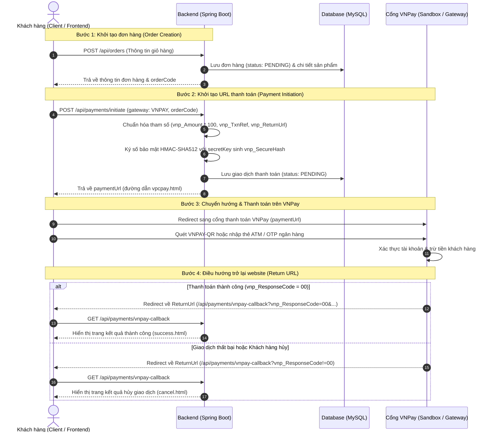

# E-Commerce Multi-Gateway Payment Integration (Spring Boot 4, Stripe & VNPay)

Dự án mẫu hướng dẫn tích hợp hệ thống thanh toán trực tuyến đa cổng (**Stripe**, **VNPay**,...) vào ứng dụng Spring Boot 4 một cách chuyên nghiệp, áp dụng các **Design Pattern** chuẩn doanh nghiệp (**Strategy Pattern**, **Factory Pattern**), phân tách rõ ràng giữa luồng Đặt hàng (Order) và Khởi tạo thanh toán (Payment Initiation).

---

## 📌 Điểm nổi bật của kiến trúc

1. **Áp dụng bộ đôi Strategy + Factory Pattern:**
   * Dễ dàng cắm/rút hoặc mở rộng thêm cổng thanh toán mới (**VNPay**, **Stripe**, **PayPal**, **VietQR**) mà không làm sửa đổi code hiện tại (Tuân thủ nguyên tắc **Open/Closed Principle**).
   * Tận dụng Spring IoC Container để tự động nạp tất cả các Strategy Bean (`StripePaymentStrategy`, `VnPayPaymentStrategy`) vào `Map` một cách linh hoạt.
2. **Tách biệt ranh giới nghiệp vụ (Decoupled Architecture):**
   * Tầng Strategy hoàn toàn độc lập với JPA Entities (`Order`, `Product`), chỉ giao tiếp thông qua hợp đồng dữ liệu chuẩn `PaymentGatewayCommand` và `LineItem`.
3. **Phân tách 2 pha: Tạo đơn trước (Order) ➜ Khởi tạo thanh toán sau (Payment):**
   * Cho phép khách hàng đổi phương thức thanh toán hoặc thử thanh toán lại khi bị từ chối thẻ mà không làm rác hay hủy đơn hàng.
4. **Tối ưu hiệu năng & An toàn dữ liệu:**
   * Tách biệt `@Transactional` khỏi các lời gọi mạng HTTP hoặc tạo checksum sang cổng thanh toán.
   * Sử dụng **Idempotency Key** trên Stripe chống trừ tiền trùng lặp khi mạng lag.
   * Xử lý chính xác thuật toán băm chữ ký số **HMAC-SHA512** bảo mật toàn vẹn dữ liệu cho VNPay (chuẩn API 2.1.0).
   * Xử lý chuẩn tiền tệ quốc tế (**Zero-Decimal Currency**): Tự động quy đổi USD sang Cents (`* 100`), giữ nguyên VND cho Stripe; nhân 100 khử số thập phân cho VNPay.

### Công nghệ sử dụng:
* **Backend:** Spring Boot 4.1.0, Spring Data JPA
* **Java Version:** JDK 25
* **Database:** MySQL 8.x
* **Cổng thanh toán:** 
  * **Stripe:** Stripe Java SDK (v33.1.1)
  * **VNPay:** VNPay Sandbox Gateway (v2.1.0, HMAC-SHA512 checksum)

---

## 💻 Thiết lập & Khởi chạy nhanh

### 1. Yêu cầu hệ thống
* Java Development Kit (JDK) 25.
* Docker và Docker Compose (để khởi chạy MySQL).

### 2. Khởi chạy MySQL
Dự án đã có sẵn cấu hình Docker. Bạn mở Terminal tại thư mục gốc và chạy lệnh:
```bash
docker-compose up -d
```

### 3. Cấu hình Cổng thanh toán (Stripe & VNPay)
Mở tệp [application.yaml](./src/main/resources/application.yaml) và điền các thông số kết nối:

```yaml
# Cấu hình Stripe Test
stripe:
  api-key: ${STRIPE_API_KEY:sk_test_YOUR_SECRET_KEY}
  success-url: http://localhost:8080/api/payments/success
  cancel-url: http://localhost:8080/api/payments/cancel

# Cấu hình VNPay Sandbox
vnpay:
  tmn-code: T3NIHXVR
  secret-key: XFHCCKKDCCZKXNXIVGUKIVIWKGHMHVZU
  vnp-url: https://sandbox.vnpayment.vn/paymentv2/vpcpay.html
  return-url: http://localhost:8080/api/payments/vnpay-callback
```

### 4. Chạy ứng dụng
Biên dịch và khởi chạy dự án:
```bash
mvn clean spring-boot:run
```

---

## 💳 Sơ đồ Luồng hoạt động Cổng thanh toán VNPay

Cổng thanh toán VNPay hoạt động theo mô hình **Chuyển hướng an toàn (Redirect Flow)** để khách hàng thanh toán trực tiếp trên hạ tầng bảo mật của cổng:



---

## 🖥️ Giao diện người dùng (Thymeleaf Frontend)

Dự án tích hợp sẵn giao diện mua hàng và thanh toán trực quan sử dụng **Thymeleaf**:
* **Trang chủ cửa hàng (`/`):** Hiển thị danh sách sản phẩm với ảnh, giá, nút Thêm vào giỏ và xem chi tiết.
* **Trang chi tiết sản phẩm (`/products/{id}`):** Xem chi tiết sản phẩm và bấm Mua ngay.
* **Trang thanh toán (`/checkout`):** Xem giỏ hàng, chọn loại tiền tệ và lựa chọn cổng thanh toán (**VNPAY**, **Stripe**, cùng trạng thái sẵn sàng cho **PayPal**, **VietQR**).
* **Trang kết quả:** Trang thành công (`/api/payments/success`, `/api/payments/vnpay-callback`) và Trang hủy (`/api/payments/cancel`).

---

## 🧪 Hướng dẫn Kiểm thử (Testing)

Mở tệp tin **[api-requests.http](./api-requests.http)** và chạy lần lượt các bước kiểm thử:

### Bước 1: Tạo đơn hàng (Order Creation)
Gửi request `POST http://localhost:8080/api/orders`:
```json
{
  "items": [
    {
      "productId": 1,
      "quantity": 1
    }
  ],
  "currency": "VND"
}
```
* Sao chép mã `"orderCode"` trả về trong JSON (Ví dụ: `ORD-A1B2C3D4`).

---

### Bước 2: Khởi tạo thanh toán (Payment Initiation)

#### Lựa chọn A: Khởi tạo thanh toán qua VNPAY
Gửi request `POST http://localhost:8080/api/payments/initiate`:
```json
{
  "orderCode": "ORD-A1B2C3D4",
  "paymentGateway": "VNPAY"
}
```
* Phản hồi trả về:
```json
{
  "status": "success",
  "message": "Payment initiated successfully",
  "data": {
    "paymentUrl": "https://sandbox.vnpayment.vn/paymentv2/vpcpay.html?vnp_Amount=8900000000&vnp_Command=pay...",
    "gatewayTransactionId": "ORD-A1B2C3D4"
  }
}
```

#### Lựa chọn B: Khởi tạo thanh toán qua STRIPE
Gửi request `POST http://localhost:8080/api/payments/initiate`:
```json
{
  "orderCode": "ORD-A1B2C3D4",
  "paymentGateway": "STRIPE"
}
```
* Phản hồi trả về:
```json
{
  "status": "success",
  "message": "Payment initiated successfully",
  "data": {
    "paymentUrl": "https://checkout.stripe.com/c/pay/cs_test_...",
    "gatewayTransactionId": "cs_test_..."
  }
}
```

---

### Bước 3: Kiểm thử thực tế trên cổng thanh toán

#### 🇻🇳 3.1. Thanh toán thử nghiệm trên VNPAY Sandbox
1. Mở `paymentUrl` của VNPAY trên trình duyệt web.
2. Tại giao diện Cổng thanh toán VNPAY:
   * **Cách 1: Thẻ ATM & Tài khoản ngân hàng nội địa:**
     * Chọn ngân hàng: **NCB** (Ngân hàng Quốc Dân).
     * Số thẻ: `9704198526191432198`
     * Tên chủ thẻ: `NGUYEN VAN A`
     * Ngày phát hành: `07/15`
     * Nhấn **Tiếp tục** ➜ Nhập mã OTP: `123456`
   * **Cách 2: Thẻ thanh toán quốc tế:**
     * Chọn loại thẻ: **VISA**
     * Số thẻ: `4456530000001005`
     * Tên chủ thẻ: `NGUYEN VAN A`
     * Ngày hết hạn: `12/26`
     * Mã CVC/CVV: `123`
3. Nhấn **Xác nhận thanh toán** ➜ VNPAY xử lý thành công và tự động chuyển hướng về `/api/payments/vnpay-callback` hiển thị giao diện Thành công.

#### 💳 3.2. Thanh toán thử nghiệm trên Stripe Checkout
1. Mở `paymentUrl` của Stripe trên trình duyệt web.
2. Nhập thông tin thẻ test của Stripe:
   * **Số thẻ (Card number):** `4242 4242 4242 4242`
   * **Hạn dùng (MM/YY):** Bất kỳ tháng/năm nào trong tương lai (Ví dụ: `12 / 29`)
   * **CVC:** `123`
   * **Tên chủ thẻ:** Tên bất kỳ (Ví dụ: `JAVABUILDER`)
3. Nhấn **Pay** ➜ Stripe xử lý và chuyển hướng về `/api/payments/success`.

---

## 📚 Tài liệu Tham khảo & Tài nguyên Cổng thanh toán (Chuyên biệt cho Java / Spring Boot)

Dưới đây là tổng hợp đầy đủ các tài liệu hướng dẫn kỹ thuật chính thức, đường dẫn tải code mẫu Java và thông tin môi trường Sandbox phục vụ quá trình tích hợp.

### 🇻🇳 Cổng thanh toán VNPAY (VNPAY Payment Gateway)

* **Trang chủ tài liệu kỹ thuật VNPAY:** [https://sandbox.vnpayment.vn/apis/](https://sandbox.vnpayment.vn/apis/)
* **Hướng dẫn tích hợp thanh toán (Redirect PAY - Bản chuẩn 2.1.0):** [VNPAY Thanh toán PAY Docs](https://sandbox.vnpayment.vn/apis/docs/thanh-toan-pay/pay.html)
* **API Truy vấn giao dịch (`querydr`) và Hoàn tiền (`refund`):** [API Truy vấn & Hoàn tiền VNPAY](https://sandbox.vnpayment.vn/apis/docs/truy-van-hoan-tien/querydr&refund.html)
* **Quy chuẩn mã hóa & Chuyển đổi thuật toán (HMAC-SHA512):** [Chuyển đổi thuật toán mã hóa](https://sandbox.vnpayment.vn/apis/docs/chuyen-doi-thuat-toan/changeTypeHash.html)
* **Danh sách mã Ngân hàng hỗ trợ (Bank Codes):** [Danh sách Ngân hàng VNPAY](https://sandbox.vnpayment.vn/apis/danh-sach-ngan-hang/)

#### 📥 Tải về Mã nguồn Mẫu Java (Java Sample Code)
* **Code Demo Java chính thức từ VNPAY (JSP / Servlet / Java Config):**
  * Link tải trực tiếp: [Tải về vnpay_jsp.zip](https://sandbox.vnpayment.vn/apis/files/vnpay_jsp.zip) *(kho lưu trữ chính thức [VNPAY Downloads](https://sandbox.vnpayment.vn/apis/downloads/))*
  * Cung cấp sẵn mã nguồn mẫu xử lý: Tạo URL thanh toán (`vnp_Command=pay`), Hàm băm `hmacSHA512`, Nhận và xác thực chữ ký số tại `vnp_ReturnUrl` và `vnp_IpnUrl`.

#### 📄 Tài liệu đặc tả kỹ thuật API (Tech Specs PDF)
* [Đặc tả kỹ thuật THANH TOÁN PAY 2.1.0 (PDF)](https://sandbox.vnpayment.vn/apis/files/VNPAY%20Payment%20Gateway_Techspec%20Post%20method%202.1.0-VN.pdf)
* [Đặc tả kỹ thuật THANH TOÁN TOKEN 2.1.0 (PDF)](https://sandbox.vnpayment.vn/apis/files/VNPAY%20Payment%20Token_Techspec%202.1.0-VN.pdf)
* [Đặc tả kỹ thuật THANH TOÁN TRẢ GÓP 2.1.1 (PDF)](https://sandbox.vnpayment.vn/apis/files/VNPAY_Installment_Payment_Techspec_2.1.1_VN.pdf)
* [Đặc tả kỹ thuật THANH TOÁN ĐỊNH KỲ 2.1.0 (PDF)](https://sandbox.vnpayment.vn/apis/files/VNPAYGW_RecurringPayment_Techspec2.1.0-VN.pdf)

#### 🧪 Môi trường Sandbox & Thông tin Thẻ Test VNPAY
* **Đăng ký tài khoản Test Sandbox (nhận `vnp_TmnCode` & `vnp_HashSecret`):** [http://sandbox.vnpayment.vn/devreg/](http://sandbox.vnpayment.vn/devreg/)
* **Kịch bản kiểm thử SIT Testing (Test Cases):** [https://sandbox.vnpayment.vn/vnpaygw-sit-testing](https://sandbox.vnpayment.vn/vnpaygw-sit-testing)
* **Trang web Demo thanh toán trực tiếp:** [VNPAY Try-it-now Demo](http://sandbox.vnpayment.vn/tryitnow/Home/CreateOrder)
* **Thẻ ATM Nội địa Test (Ngân hàng NCB):**
  * **Ngân hàng:** `NCB`
  * **Số thẻ:** `9704198526191432198`
  * **Tên chủ thẻ:** `NGUYEN VAN A`
  * **Ngày phát hành:** `07/15`
  * **Mã OTP:** `123456`
* **Thẻ Quốc tế Test (Visa No-3DS):**
  * **Số thẻ:** `4456530000001005`
  * **CVC/CVV:** `123`
  * **Hạn sử dụng:** `12/26`
  * **Tên chủ thẻ:** `NGUYEN VAN A`

