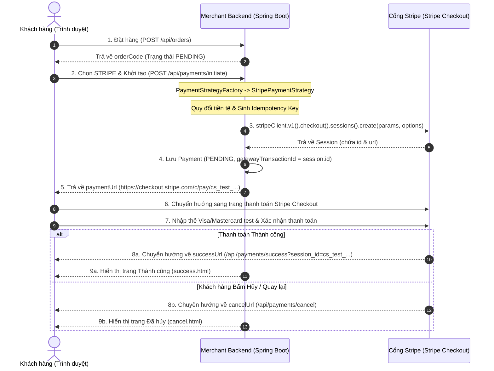

# 💳 Hướng Dẫn Tích Hợp Cổng Thanh Toán Stripe Checkout (Stripe Gateway for Java & Spring Boot)

Tài liệu hướng dẫn chi tiết toàn bộ quy trình tích hợp cổng thanh toán trực tuyến quốc tế **Stripe Checkout** (sử dụng thư viện chính thức **Stripe Java SDK v33.1.1**) vào ứng dụng **Java Spring Boot**, áp dụng mô hình thiết kế **Strategy Pattern + Factory Pattern**. Hỗ trợ thanh toán toàn cầu qua Thẻ quốc tế (Visa, Mastercard, American Express,...), Apple Pay, Google Pay và xử lý đa tiền tệ chuẩn (USD cents, VND zero-decimal).

---

## 📌 Mục Lục
1. [Tài liệu chính thức & Tài nguyên Stripe](#1-tai-lieu-chinh-thuc-tai-nguyen-stripe)
2. [Kiến trúc & Luồng hoạt động (Sequence Diagram)](#2-kien-truc-luong-hoat-dong-sequence-diagram)
3. [Môi trường Thử nghiệm & Thông tin thẻ Test](#3-moi-truong-thu-nghiem-thong-tin-the-test)
4. [Cấu hình tham số Spring Boot (application.yaml & pom.xml)](#4-cau-hinh-tham-so-spring-boot-applicationyaml-pomxml)
5. [Cấu trúc mã nguồn & Triển khai chi tiết (Strategy Pattern)](#5-cau-truc-ma-nguon-trien-khai-chi-tiet-strategy-pattern)
   * [5.1. Cấu hình StripeClient Bean (StripeClientConfiguration)](#51-cau-hinh-stripeclient-bean-stripeclientconfiguration)
   * [5.2. Khế ước chung (PaymentStrategy & PaymentGatewayCommand)](#52-khe-uoc-chung-paymentstrategy-paymentgatewaycommand)
   * [5.3. Chiến lược thanh toán Stripe (StripePaymentStrategy)](#53-chien-luoc-thanh-toan-stripe-stripepaymentstrategy)
   * [5.4. Nhà máy khởi tạo (PaymentStrategyFactory)](#54-nha-may-khoi-tao-paymentstrategyfactory)
   * [5.5. Tầng nghiệp vụ thanh toán (PaymentService)](#55-tang-nghiep-vu-thanh-toan-paymentservice)
   * [5.6. Lớp API tiếp nhận (PaymentController)](#56-lop-api-tiep-nhan-paymentcontroller)
   * [5.7. Điều hướng kết quả thanh toán (ViewController)](#57-dieu-huong-ket-qua-thanh-toan-viewcontroller)
6. [Quy chuẩn xử lý & Lưu ý sống còn](#6-quy-chuan-xu-ly-luu-y-song-con)
7. [Hướng dẫn kiểm thử thực tế (Testing & API Requests)](#7-huong-dan-kiem-thu-thuc-te-testing-api-requests)

---

<a id="1-tai-lieu-chinh-thuc-tai-nguyen-stripe"></a>
## 1. 📚 Tài liệu chính thức & Tài nguyên Stripe

* **Trang chủ tài liệu kỹ thuật Stripe Docs:** [https://stripe.com/docs](https://stripe.com/docs)
* **Tài liệu Stripe Checkout (Prebuilt Checkout Page):** [Stripe Checkout Overview](https://stripe.com/docs/payments/checkout)
* **Kho lưu trữ chính thức Stripe Java SDK (GitHub):** [stripe/stripe-java](https://github.com/stripe/stripe-java)
* **Tài liệu Stripe API Reference (chọn Java):** [Stripe API Reference - Java](https://stripe.com/docs/api?lang=java)
* **Hướng dẫn chống trùng lặp giao dịch (Idempotent Requests):** [Stripe Idempotent Requests](https://stripe.com/docs/api/idempotent_requests)
* **Quy chuẩn đơn vị tiền tệ & Zero-decimal currencies:** [Stripe Currencies Guide](https://stripe.com/docs/currencies#zero-decimal)
* **Hướng dẫn tích hợp Webhook cho Java:** [Stripe Webhooks Guide](https://stripe.com/docs/webhooks)
* **Công cụ Stripe CLI (Test & Forward Webhook tại local):** [Stripe CLI Documentation](https://stripe.com/docs/stripe-cli)

---

<a id="2-kien-truc-luong-hoat-dong-sequence-diagram"></a>
## 2. 🏗️ Kiến trúc & Luồng hoạt động (Sequence Diagram)

Mô hình hoạt động của **Stripe Checkout Session** áp dụng kiến trúc **Redirect Flow** an toàn: Khách hàng không nhập thẻ trực tiếp trên máy chủ backend của ứng dụng mà chuyển hướng sang giao diện được chứng nhận chuẩn PCI-DSS của Stripe.



---

<a id="3-moi-truong-thu-nghiem-thong-tin-the-test"></a>
## 3. 🧪 Môi trường Thử nghiệm & Thông tin thẻ Test

Stripe cung cấp chế độ **Test Mode** hoàn toàn miễn phí mà không cần kích hoạt tài khoản thật.

### 3.1. Đăng ký tài khoản & Lấy API Key
1. Đăng ký tài khoản tại [https://dashboard.stripe.com/register](https://dashboard.stripe.com/register).
2. Bật công tắc **Test mode** trên góc màn hình Dashboard.
3. Truy cập mục **Developers** ➜ **API keys** để sao chép **Secret key** (bắt đầu bằng `sk_test_...`).

### 3.2. Danh sách thẻ Test chính thức của Stripe
Khi giao diện Stripe Checkout hiện lên, bạn có thể sử dụng các số thẻ thử nghiệm sau:

| Loại thẻ / Kịch bản kiểm thử | Số thẻ (Card Number) | Hạn dùng (MM/YY) | CVC | Kết quả mong đợi |
| :--- | :--- | :--- | :--- | :--- |
| **Thẻ chuẩn (Thanh toán thành công)** | `4242 4242 4242 4242` | Bất kỳ tương lai (vd: `12/29`) | `123` | Thanh toán thành công ngay lập tức |
| **Thẻ yêu cầu 3D Secure (3DS)** | `4000 0000 0000 3063` | Bất kỳ tương lai | `123` | Bật popup xác thực OTP thử nghiệm |
| **Thẻ bị từ chối (Card Declined)** | `4000 0000 0000 0002` | Bất kỳ tương lai | `123` | Báo lỗi thẻ bị từ chối |
| **Thẻ hết tiền (Insufficient Funds)** | `4000 0000 0000 0119` | Bất kỳ tương lai | `123` | Báo lỗi tài khoản không đủ số dư |
| **Thẻ hết hạn (Expired Card)** | `4000 0000 0000 0069` | Bất kỳ tương lai | `123` | Báo lỗi thẻ hết hạn |

> **Mẹo:** Họ tên chủ thẻ và Mã bưu chính (ZIP/Postal Code) có thể điền tùy ý (ví dụ: `JAVABUILDER`, `70000`).

---

<a id="4-cau-hinh-tham-so-spring-boot-applicationyaml-pomxml"></a>
## 4. ⚙️ Cấu hình tham số Spring Boot (application.yaml & pom.xml)

### 4.1. Thư viện phụ thuộc `pom.xml`
Dự án sử dụng thư viện **Stripe Java SDK** bản mới nhất:

```xml
<dependency>
    <groupId>com.stripe</groupId>
    <artifactId>stripe-java</artifactId>
    <version>33.1.1</version>
</dependency>
```

### 4.2. Cấu hình kết nối trong `src/main/resources/application.yaml`
```yaml
stripe:
  api-key: ${STRIPE_API_KEY:sk_test_mock_key}
  return-url: ${STRIPE_SUCCESS_URL:http://localhost:8080/api/payments/success}
  cancel-url: ${STRIPE_CANCEL_URL:http://localhost:8080/api/payments/cancel}
```

* `stripe.api-key`: Khóa bí mật dùng cho backend (`sk_test_...`).
* `stripe.return-url`: URL điều hướng về khi khách hàng thanh toán thành công (hỗ trợ tham số `{CHECKOUT_SESSION_ID}` để Stripe tự inject Session ID).
* `stripe.cancel-url`: URL điều hướng về khi khách hàng chủ động bấm "Huỷ và quay lại cửa hàng".

---

<a id="5-cau-truc-ma-nguon-trien-khai-chi-tiet-strategy-pattern"></a>
## 5. 💻 Cấu trúc mã nguồn & Triển khai chi tiết (Strategy Pattern)

Hệ thống thanh toán được chuẩn hóa theo mô hình **Strategy Pattern**:
* Tách biệt logic thanh toán khỏi thực thể cơ sở dữ liệu (`Order`, `Product`).
* `PaymentService` chỉ điều phối và ủy quyền cho `PaymentStrategyFactory`.
* Mỗi cổng thanh toán là một Bean độc lập triển khai `PaymentStrategy`.

<a id="51-cau-hinh-stripeclient-bean-stripeclientconfiguration"></a>
### 5.1. Cấu hình StripeClient Bean (`StripeClientConfiguration.java`)
Thay vì dùng biến static toàn cục cũ (`Stripe.apiKey = ...`), dự án sử dụng đối tượng `StripeClient` quản lý theo vòng đời Spring Bean:

```java
package com.javabuilder.stripe.configuration;

import com.stripe.StripeClient;
import org.springframework.beans.factory.annotation.Value;
import org.springframework.context.annotation.Bean;
import org.springframework.context.annotation.Configuration;

@Configuration
public class StripeClientConfiguration {

    // Tiêm khóa bí mật Stripe API Key từ application.yaml
    @Value("${stripe.api-key}")
    private String apiKey;

    // Khởi tạo StripeClient chính thức từ Stripe Java SDK
    @Bean
    public StripeClient stripeClient() {
        return StripeClient.builder()
                .setApiKey(apiKey) // Cài đặt Secret Key dùng cho mọi cuộc gọi API
                .build();
    }
}
```

#### 🔍 Giải thích chi tiết hàm và SDK Stripe:
* **`StripeClient.builder().setApiKey(apiKey).build()`**: Khởi tạo client chính thức của thư viện `stripe-java`. Đối tượng `StripeClient` quản lý kết nối HTTP, cấu hình retry tự động và đảm bảo an toàn đa luồng (thread-safe) thay thế cho cách gán static biến toàn cục `Stripe.apiKey` cũ. Mọi API của Stripe (v1, checkout, payment intents) đều được truy xuất thông qua client này.

---

<a id="52-khe-uoc-chung-paymentstrategy-paymentgatewaycommand"></a>
### 5.2. Khế ước chung (`PaymentStrategy.java` & `PaymentGatewayCommand.java`)

#### Giao diện chiến lược thanh toán:
```java
package com.javabuilder.stripe.strategy;

import com.javabuilder.stripe.common.PaymentGateway;
import com.javabuilder.stripe.dto.response.PaymentGatewayResponse;
import com.javabuilder.stripe.strategy.dto.PaymentGatewayCommand;

public interface PaymentStrategy {
    // 1. Định danh cổng thanh toán của chiến lược (STRIPE, PAYPAL, VNPAY)
    PaymentGateway getPaymentGateway();

    // 2. Tiếp nhận lệnh chuẩn hóa và xử lý tạo phiên thanh toán trên cổng
    PaymentGatewayResponse processPayment(PaymentGatewayCommand command);
}
```

#### Hợp đồng dữ liệu truyền vào cổng thanh toán (Command DTO):
```java
package com.javabuilder.stripe.strategy.dto;

import com.javabuilder.stripe.common.Currency;
import lombok.Builder;

import java.math.BigDecimal;
import java.util.List;

@Builder
public record PaymentGatewayCommand(
        String orderCode,          // Mã đơn hàng duy nhất của Merchant
        BigDecimal totalPrice,     // Tổng số tiền cần thanh toán
        Currency currency,         // Đơn vị tiền tệ (USD, VND)
        String clientIp,           // Địa chỉ IP của khách hàng
        List<LineItem> lineItems   // Danh sách chi tiết các sản phẩm trong đơn
) {

    @Builder
    public record LineItem (
            String name,           // Tên sản phẩm hiển thị trên hóa đơn
            Integer quantity,      // Số lượng sản phẩm
            BigDecimal unitPrice   // Đơn giá cho mỗi sản phẩm
    ) {}
}
```

#### 🔍 Giải thích chi tiết hàm và mã nguồn:
* **`PaymentStrategy` (Strategy Interface)**: Đóng vai trò là hợp đồng kỹ thuật chung cho tất cả các cổng thanh toán. Bất kỳ cổng thanh toán nào muốn tích hợp vào hệ thống đều phải triển khai interface này.
* **`PaymentGatewayCommand` (Command Pattern)**: Gom toàn bộ dữ liệu cần thiết của đơn hàng (`orderCode`, `totalPrice`, `currency`, `lineItems`) thành một DTO độc lập. Nhờ đó, các class Strategy không bị phụ thuộc vào entity JPA `Order` của hệ thống.

---

<a id="53-chien-luoc-thanh-toan-stripe-stripepaymentstrategy"></a>
### 5.3. Chiến lược thanh toán Stripe (`StripePaymentStrategy.java`)

```java
package com.javabuilder.stripe.strategy.stripe;

import com.javabuilder.stripe.common.Currency;
import com.javabuilder.stripe.common.PaymentGateway;
import com.javabuilder.stripe.dto.response.PaymentGatewayResponse;
import com.javabuilder.stripe.exception.AppException;
import com.javabuilder.stripe.exception.ErrorCode;
import com.javabuilder.stripe.strategy.PaymentStrategy;
import com.javabuilder.stripe.strategy.dto.PaymentGatewayCommand;
import com.stripe.StripeClient;
import com.stripe.exception.StripeException;
import com.stripe.model.checkout.Session;
import com.stripe.net.RequestOptions;
import com.stripe.param.checkout.SessionCreateParams;
import lombok.RequiredArgsConstructor;
import lombok.extern.slf4j.Slf4j;
import org.springframework.beans.factory.annotation.Value;
import org.springframework.stereotype.Component;

import java.math.BigDecimal;
import java.math.RoundingMode;

@Component
@RequiredArgsConstructor
@Slf4j(topic = "STRIPE-PAYMENT-STRATEGY")
public class StripePaymentStrategy implements PaymentStrategy {

    // Tiêm URL điều hướng kết quả thanh toán từ application.yaml
    @Value("${stripe.return-url}")
    private String returnUrl;

    // Tiêm URL điều hướng khi hủy thanh toán từ application.yaml
    @Value("${stripe.cancel-url}")
    private String cancelUrl;

    // Tiêm StripeClient Bean đã cấu hình từ SDK
    private final StripeClient stripeClient;

    @Override
    public PaymentGateway getPaymentGateway() {
        return PaymentGateway.STRIPE;
    }

    @Override
    public PaymentGatewayResponse processPayment(PaymentGatewayCommand command) {
        // 1. Khởi tạo SessionCreateParams builder của Stripe SDK
        SessionCreateParams.Builder sessionBuilder = SessionCreateParams.builder()
                .setSuccessUrl(returnUrl + "?session_id={CHECKOUT_SESSION_ID}") // Tự động inject Session ID
                .setCancelUrl(cancelUrl)
                .setClientReferenceId(command.orderCode()) // Lưu mã đơn hàng orderCode để đối soát
                .putMetadata("orderCode", command.orderCode()) // Metadata hiển thị trên Stripe Dashboard
                .setMode(SessionCreateParams.Mode.PAYMENT); // Chế độ thanh toán 1 lần

        // 2. Thêm từng LineItem vào giỏ hàng Stripe Checkout
        for (PaymentGatewayCommand.LineItem lineItem : command.lineItems()) {
            Long itemAmount = toStripeAmount(lineItem.unitPrice(), command.currency());

            sessionBuilder.addLineItem(SessionCreateParams.LineItem.builder()
                    .setQuantity(lineItem.quantity().longValue())
                    .setPriceData(SessionCreateParams.LineItem.PriceData.builder()
                            .setCurrency(command.currency().toStripeCode()) // "usd" hoặc "vnd"
                            .setUnitAmount(itemAmount) // Đơn vị nhỏ nhất của Stripe
                            .setProductData(SessionCreateParams.LineItem.PriceData.ProductData.builder()
                                    .setName(lineItem.name()) // Tên sản phẩm hiển thị trên hóa đơn
                                    .build())
                            .build())
                    .build());
        }

        SessionCreateParams params = sessionBuilder.build();
        
        // 3. RequestOptions: gắn Idempotency Key theo mã đơn hàng orderCode
        RequestOptions options = RequestOptions.builder()
                .setIdempotencyKey("checkout-" + command.orderCode())
                .build();

        try {
            // 4. Gọi API Stripe: POST /v1/checkout/sessions để tạo phiên thanh toán
            Session session = stripeClient.v1().checkout().sessions().create(params, options);
            
            // 5. Trích xuất Stripe Session ID và URL thanh toán chuyển tiếp
            return PaymentGatewayResponse.builder()
                    .gatewayTransactionId(session.getId())
                    .paymentUrl(session.getUrl())
                    .build();
        } catch (StripeException e) {
            log.error("Stripe Checkout Session creation failed", e);
            throw new AppException(ErrorCode.STRIPE_INTEGRATION_FAILED);
        }
    }

    // 6. Quy đổi số tiền theo chuẩn Zero-Decimal của Stripe
    private Long toStripeAmount(BigDecimal amount, Currency currency) {
        if (amount == null) {
            return 0L;
        }
        return currency.isZeroDecimal() ?
                amount.setScale(0, RoundingMode.HALF_UP).longValue() :
                amount.multiply(BigDecimal.valueOf(100)).setScale(0, RoundingMode.HALF_UP).longValue();
    }
}
```

#### 🔍 Giải thích chi tiết các hàm và đối tượng Stripe SDK:
* **`SessionCreateParams.Builder`**: Lớp xây dựng tham số yêu cầu tạo Checkout Session của Stripe SDK:
  * **`.setSuccessUrl(returnUrl + "?session_id={CHECKOUT_SESSION_ID}")`**: Nhận `return-url`. Macro `{CHECKOUT_SESSION_ID}` là biến giữ chỗ (placeholder) do Stripe tự động hoán đổi thành Session ID thực tế (dạng `cs_test_...`) khi khách hàng thanh toán xong.
  * **`.setCancelUrl(cancelUrl)`**: URL chuyển hướng khi khách hàng bấm nút quay lại hoặc hủy thanh toán trên trang Stripe.
  * **`.setClientReferenceId(command.orderCode())` & `.putMetadata("orderCode", ...)`**: Gắn mã đơn hàng `orderCode` vào phiên thanh toán để liên kết và đối soát đơn hàng trên Stripe Dashboard / Webhook.
  * **`.setMode(SessionCreateParams.Mode.PAYMENT)`**: Định cấu hình luồng Checkout là thanh toán đơn hàng một lần (thay vì `SETUP` hoặc `SUBSCRIPTION`).
* **`LineItem` & `PriceData`**:
  * **`setCurrency(command.currency().toStripeCode())`**: Stripe quy định mã tiền tệ phải viết thường dạng ISO-4217 (ví dụ: `"usd"`, `"vnd"`).
  * **`setUnitAmount(itemAmount)`**: Đơn vị tính toán nhỏ nhất của Stripe. Với các đồng tiền Zero-Decimal như `VND` thì giữ nguyên; với tiền có số thập phân như `USD` thì nhân 100 thành cents ($10.00 = 1000 cents).
* **`RequestOptions.builder().setIdempotencyKey("checkout-" + command.orderCode())`**: Cơ chế Idempotency chống trừ tiền 2 lần từ Stripe. Nếu client gửi lại request cùng `orderCode` do mạng chập chờn, Stripe sẽ trả về phiên đã tạo thay vì tính tiền lần nữa.
* **`stripeClient.v1().checkout().sessions().create(params, options)`**: Hàm gọi trực tiếp API `POST /v1/checkout/sessions` của Stripe để tạo phiên.
* **`session.getId()` & `session.getUrl()`**: `session.getId()` là Stripe Session ID lưu vào `gatewayTransactionId` trong Database để đối soát; `session.getUrl()` là đường link chuyển hướng người mua sang trang thanh toán của Stripe.

---

<a id="54-nha-may-khoi-tao-paymentstrategyfactory"></a>
### 5.4. Nhà máy khởi tạo (`PaymentStrategyFactory.java`)

```java
package com.javabuilder.stripe.strategy;

import com.javabuilder.stripe.common.PaymentGateway;
import lombok.extern.slf4j.Slf4j;
import org.springframework.stereotype.Component;

import java.util.List;
import java.util.Map;
import java.util.Optional;
import java.util.function.Function;
import java.util.stream.Collectors;

@Component
@Slf4j(topic = "PAYMENT-STRATEGY-FACTORY")
public class PaymentStrategyFactory {

    // 1. Map lưu trữ Strategy theo PaymentGateway tương ứng
    private final Map<PaymentGateway, PaymentStrategy> paymentStrategyMap;

    // 2. Constructor nhận vào danh sách tất cả các Bean PaymentStrategy được Spring tự động nạp
    public PaymentStrategyFactory(List<PaymentStrategy> strategies) {
        this.paymentStrategyMap = strategies.stream()
                .collect(Collectors.toMap(PaymentStrategy::getPaymentGateway, Function.identity()));
        log.info("PaymentStrategyFactory loaded successfully with gateways: {}", paymentStrategyMap.keySet());
    }

    // 3. Phương thức lấy Strategy dựa vào PaymentGateway enum
    public PaymentStrategy getPaymentStrategy(PaymentGateway paymentGateway) {
        return Optional.ofNullable(paymentStrategyMap.get(paymentGateway))
                .orElseThrow(() -> new IllegalArgumentException("Payment strategy not found for gateway: " + paymentGateway));
    }
}
```

#### 🔍 Giải thích chi tiết hàm và logic xử lý:
* **`PaymentStrategyFactory(List<PaymentStrategy> strategies)`**: Áp dụng tính năng Dependency Injection linh hoạt của Spring. Mọi class được đánh dấu `@Component` và implements `PaymentStrategy` (`StripePaymentStrategy`, `PaypalPaymentStrategy`, `VnPayPaymentStrategy`) sẽ được gom thành một danh sách và ánh xạ vào `Map`. Khi thêm cổng mới, ta chỉ cần tạo class mới mà không cần chỉnh sửa Factory (nguyên lý Open/Closed).

---

<a id="55-tang-nghiep-vu-thanh-toan-paymentservice"></a>
### 5.5. Tầng nghiệp vụ thanh toán (`PaymentService.java`)

```java
package com.javabuilder.stripe.service;

import com.javabuilder.stripe.common.OrderStatus;
import com.javabuilder.stripe.common.PaymentStatus;
import com.javabuilder.stripe.dto.request.PaymentInitRequest;
import com.javabuilder.stripe.dto.response.PaymentGatewayResponse;
import com.javabuilder.stripe.dto.response.PaymentInitResponse;
import com.javabuilder.stripe.entity.Order;
import com.javabuilder.stripe.entity.Payment;
import com.javabuilder.stripe.exception.AppException;
import com.javabuilder.stripe.exception.ErrorCode;
import com.javabuilder.stripe.repository.OrderRepository;
import com.javabuilder.stripe.repository.PaymentRepository;
import com.javabuilder.stripe.strategy.PaymentStrategy;
import com.javabuilder.stripe.strategy.PaymentStrategyFactory;
import com.javabuilder.stripe.strategy.dto.PaymentGatewayCommand;
import lombok.RequiredArgsConstructor;
import lombok.extern.slf4j.Slf4j;
import org.springframework.stereotype.Service;
import org.springframework.transaction.annotation.Transactional;

@Service
@RequiredArgsConstructor
@Slf4j(topic = "PAYMENT-SERVICE")
public class PaymentService {

    private final PaymentRepository paymentRepository;
    private final OrderRepository orderRepository;
    private final PaymentStrategyFactory paymentStrategyFactory;

    @Transactional(rollbackFor = Exception.class)
    public PaymentInitResponse initiatePayment(PaymentInitRequest request, String clientIp) {
        // 1. Tìm đơn hàng theo mã orderCode trong cơ sở dữ liệu
        Order order = orderRepository.findByOrderCode(request.orderCode())
                .orElseThrow(() -> new AppException(ErrorCode.ORDER_NOT_FOUND));

        // 2. Chặn khởi tạo lại thanh toán nếu đơn hàng đã được trả tiền thành công
        if (order.getOrderStatus() == OrderStatus.SUCCESS) {
            throw new IllegalStateException("This order has already been paid!");
        }

        // 3. Chuyển đổi dữ liệu đơn hàng sang PaymentGatewayCommand
        PaymentGatewayCommand command = PaymentGatewayCommand.builder()
                .orderCode(order.getOrderCode())
                .totalPrice(order.getTotalPrice())
                .currency(order.getCurrency())
                .clientIp(clientIp)
                .lineItems(order.getOrderDetails().stream().map(orderDetail -> PaymentGatewayCommand.LineItem.builder()
                        .name(orderDetail.getProduct().getName())
                        .quantity(orderDetail.getQuantity())
                        .unitPrice(orderDetail.getPrice())
                        .build())
                        .toList())
                .build();

        // 4. Lấy Strategy tương ứng với cổng thanh toán được chọn (STRIPE)
        PaymentStrategy paymentStrategy = paymentStrategyFactory.getPaymentStrategy(request.paymentGateway());
        
        // 5. Thực thi khởi tạo phiên thanh toán trên cổng
        PaymentGatewayResponse paymentGatewayResponse = paymentStrategy.processPayment(command);

        // 6. Lưu bản ghi Payment ở trạng thái PENDING kèm Stripe Session ID vào Database
        Payment payment = Payment.builder()
                .order(order)
                .paymentGateway(request.paymentGateway())
                .amount(order.getTotalPrice())
                .currency(order.getCurrency())
                .gatewayTransactionId(paymentGatewayResponse.gatewayTransactionId())
                .paymentStatus(PaymentStatus.PENDING)
                .build();
        paymentRepository.save(payment);
        log.info("Payment transaction saved successfully. ID: {}, Stripe Session ID: {}", payment.getId(), paymentGatewayResponse.gatewayTransactionId());

        // 7. Trả về kết quả chứa đường dẫn thanh toán cho client
        return PaymentInitResponse.builder()
                .paymentUrl(paymentGatewayResponse.paymentUrl())
                .gatewayTransactionId(paymentGatewayResponse.gatewayTransactionId())
                .build();
    }
}
```

#### 🔍 Giải thích chi tiết hàm và logic xử lý:
* **`initiatePayment()`**: Thực hiện toàn bộ quy trình thanh toán từ nhận request, validate trạng thái đơn hàng, tạo command, gọi strategy và lưu transaction.
* **`gatewayTransactionId(paymentGatewayResponse.gatewayTransactionId())`**: Lưu ID phiên làm việc của cổng thanh toán (`session.getId()` với Stripe) vào cột `gateway_transaction_id` của bảng `payments` để đối soát sau này khi nhận Webhook hoặc Callback.

---

<a id="56-lop-api-tiep-nhan-paymentcontroller"></a>
### 5.6. Lớp API tiếp nhận (`PaymentController.java`)
Cung cấp endpoint RESTful tiếp nhận yêu cầu khởi tạo thanh toán từ Frontend:

```java
package com.javabuilder.stripe.controller;

import com.javabuilder.stripe.dto.request.PaymentInitRequest;
import com.javabuilder.stripe.dto.response.ApiResponse;
import com.javabuilder.stripe.dto.response.PaymentInitResponse;
import com.javabuilder.stripe.service.PaymentService;
import com.javabuilder.stripe.util.HttpUtils;
import jakarta.servlet.http.HttpServletRequest;
import jakarta.validation.Valid;
import lombok.RequiredArgsConstructor;
import org.springframework.http.HttpStatus;
import org.springframework.web.bind.annotation.*;

@RestController
@RequiredArgsConstructor
@RequestMapping("/api/payments")
public class PaymentController {

    private final PaymentService paymentService;

    // 1. Endpoint POST /api/payments/initiate tiếp nhận yêu cầu thanh toán
    @PostMapping("/initiate")
    @ResponseStatus(HttpStatus.CREATED)
    ApiResponse<PaymentInitResponse> initiatePayment(@RequestBody @Valid PaymentInitRequest request, HttpServletRequest httpServletRequest) {
        // 2. Trích xuất địa chỉ IP của Client từ HttpServletRequest
        String clientIp = HttpUtils.getClientIpAddress(httpServletRequest);
        
        // 3. Gọi PaymentService khởi tạo thanh toán
        var data = paymentService.initiatePayment(request, clientIp);
        
        // 4. Trả về ApiResponse chuẩn hóa bọc PaymentInitResponse
        return ApiResponse.<PaymentInitResponse>builder()
                .status("success")
                .message("Payment initiated successfully")
                .data(data)
                .build();
    }
}
```

#### 🔍 Giải thích chi tiết hàm và logic xử lý:
* **`@PostMapping("/initiate")`**: Tiếp nhận request dạng JSON chứa `orderCode` và `paymentGateway`.
* **`HttpUtils.getClientIpAddress(httpServletRequest)`**: Đọc chính xác địa chỉ IP của client (xử lý cả trường hợp qua Proxy/Load Balancer với header `X-Forwarded-For`).
* **`ApiResponse<PaymentInitResponse>`**: Chuẩn hóa định dạng JSON trả về cho frontend với cấu trúc đồng nhất (`status`, `message`, `data`).

---

<a id="57-dieu-huong-ket-qua-thanh-toan-viewcontroller"></a>
### 5.7. Điều hướng kết quả thanh toán (`ViewController.java`)

```java
package com.javabuilder.stripe.controller;

import com.javabuilder.stripe.service.ProductService;
import lombok.RequiredArgsConstructor;
import org.springframework.stereotype.Controller;
import org.springframework.ui.Model;
import org.springframework.web.bind.annotation.GetMapping;
import org.springframework.web.bind.annotation.RequestParam;

@Controller
@RequiredArgsConstructor
public class ViewController {

    private final ProductService productService;

    // 1. Endpoint hiển thị giao diện khi thanh toán thành công
    @GetMapping("/api/payments/success")
    public String success(@RequestParam(value = "session_id", required = false) String sessionId, Model model) {
        // Đưa Session ID sang giao diện Thymeleaf (success.html)
        model.addAttribute("sessionId", sessionId != null ? sessionId : "STRIPE-SUCCESS");
        return "success";
    }

    // 2. Endpoint hiển thị giao diện khi khách hàng hủy thanh toán
    @GetMapping("/api/payments/cancel")
    public String cancel() {
        return "cancel";
    }
}
```

#### 🔍 Giải thích chi tiết hàm:
* **`@GetMapping("/api/payments/success")`**: Được gọi khi Stripe điều hướng khách hàng trở về website sau khi thanh toán thành công trên Stripe Checkout. Param `session_id` được trích xuất và hiển thị trên giao diện `success.html`.
* **`@GetMapping("/api/payments/cancel")`**: Được gọi khi khách hàng click nút quay lại / hủy bỏ trên trang Stripe Checkout để hiển thị trang `cancel.html`.

---

<a id="6-quy-chuan-xu-ly-luu-y-song-con"></a>
## 6. ⚠️ Quy chuẩn xử lý & Lưu ý sống còn

### 6.1. Quy chuẩn tiền tệ Zero-Decimal (Zero-Decimal Currencies)
* Các loại tiền như `USD`, `EUR` có đơn vị nhỏ hơn (cents). Stripe yêu cầu gửi số tiền dưới dạng số nguyên nhỏ nhất: `$10.50` ➜ `1050`.
* Các loại tiền như `VND`, `JPY` **không có đơn vị phụ (zero-decimal)**. Khi gửi `100,000 VND`, bạn phải gửi đúng `100000`, **tuyệt đối không nhân 100**. Nếu nhân 100, khách hàng sẽ bị tính thành `10,000,000 VND`.
* Enum `Currency.java` trong dự án được thiết kế chuẩn:
  ```java
  public enum Currency {
      VND, USD;

      public String toStripeCode() {
          return name().toLowerCase();
      }

      public boolean isZeroDecimal() {
          return this == VND;
      }
  }
  ```

### 6.2. Tính bất biến chống trừ tiền trùng lặp (Idempotency Key)
* Khi mạng của khách hàng chập chờn, họ có thể bấm gửi request thanh toán nhiều lần.
* Bằng cách truyền `RequestOptions.builder().setIdempotencyKey("checkout-" + command.orderCode()).build()`, Stripe nhận diện các request trùng `IdempotencyKey` và chỉ trả về phiên đã tạo trước đó mà không trừ tiền hay tạo phiên mới.

### 6.3. Đối soát qua Webhook (Production Ready)
* Khi triển khai production, kết quả cuối cùng phải được đối soát thông qua **Stripe Webhook** (`checkout.session.completed`), không chỉ dựa vào việc người dùng redirect về `successUrl` (để tránh trường hợp người dùng đóng trình duyệt trước khi redirect).

---

<a id="7-huong-dan-kiem-thu-thuc-te-testing-api-requests"></a>
## 7. 🧪 Hướng dẫn kiểm thử thực tế (Testing & API Requests)

### Bước 1: Tạo đơn hàng mẫu
Gửi request `POST http://localhost:8080/api/orders`:
```json
{
  "items": [
    {
      "productId": 1,
      "quantity": 1
    }
  ],
  "currency": "USD"
}
```
* Phản hồi: Nhận được `"orderCode": "ORD-XXXXXXXX"`.

### Bước 2: Khởi tạo phiên thanh toán Stripe
Gửi request `POST http://localhost:8080/api/payments/initiate`:
```json
{
  "orderCode": "ORD-XXXXXXXX",
  "paymentGateway": "STRIPE"
}
```

* Phản hồi:
```json
{
  "status": "success",
  "message": "Payment initiated successfully",
  "data": {
    "paymentUrl": "https://checkout.stripe.com/c/pay/cs_test_a1b2c3...",
    "gatewayTransactionId": "cs_test_a1b2c3..."
  }
}
```

### Bước 3: Hoàn tất thanh toán
1. Mở đường link `paymentUrl` trên trình duyệt.
2. Nhập thông tin thẻ test: `4242 4242 4242 4242`, MM/YY tương lai, CVC `123`.
3. Bấm **Pay** ➜ Stripe chuyển hướng về `http://localhost:8080/api/payments/success?session_id=cs_test_...` hiển thị giao diện thành công.
