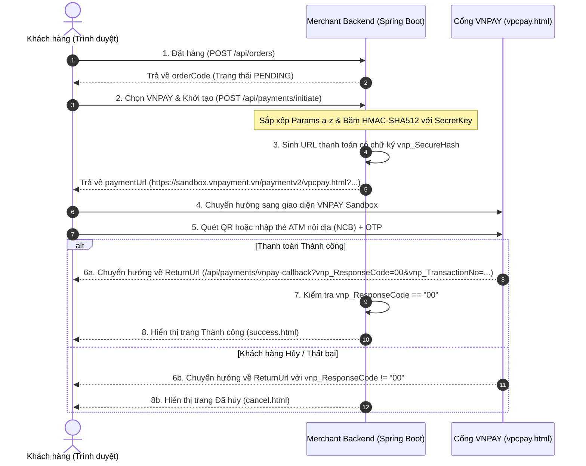

# 🇻🇳 Hướng Dẫn Tích Hợp Cổng Thanh Toán VNPAY (VNPAY Payment Gateway for Java & Spring Boot)

Tài liệu hướng dẫn chi tiết toàn bộ quy trình tích hợp cổng thanh toán trực tuyến **VNPAY** (phiên bản kỹ thuật chuẩn **2.1.0** với mã hóa **HMAC-SHA512**) vào ứng dụng **Java Spring Boot**, áp dụng mô hình **Strategy Pattern + Factory Pattern**. Hỗ trợ thanh toán qua mã VNPAY-QR, Thẻ ATM/Tài khoản 40+ ngân hàng nội địa và Thẻ thanh toán quốc tế (Visa, Mastercard, JCB).

---

## 📌 Mục Lục
1. [Tài liệu chính thức & Tài nguyên VNPAY](#1-tai-lieu-chinh-thuc-tai-nguyen-vnpay)
2. [Kiến trúc & Luồng hoạt động (Sequence Diagram)](#2-kien-truc-luong-hoat-dong-sequence-diagram)
3. [Môi trường Sandbox & Thông tin thẻ Test](#3-moi-truong-sandbox-thong-tin-the-test)
4. [Cấu hình tham số Spring Boot (application.yaml)](#4-cau-hinh-tham-so-spring-boot-applicationyaml)
5. [Cấu trúc mã nguồn & Triển khai chi tiết](#5-cau-truc-ma-nguon-trien-khai-chi-tiet)
   * [5.1. Lớp cấu hình thuộc tính (VnPayProperties)](#51-lop-cau-hinh-thuoc-tinh-vnpayproperties)
   * [5.2. Tiện ích mã hóa HMAC-SHA512 (VnPayUtils)](#52-tien-ich-ma-hoa-hmac-sha512-vnpayutils)
   * [5.3. Chiến lược thanh toán VNPAY (VnPayPaymentStrategy)](#53-chien-luoc-thanh-toan-vnpay-vnpaypaymentstrategy)
   * [5.4. Tích hợp với Factory & PaymentService](#54-tich-hop-voi-factory-paymentservice)
   * [5.5. Xử lý Callback kết quả thanh toán (vnp_ReturnUrl)](#55-xu-ly-callback-ket-qua-thanh-toan-vnp-returnurl)
6. [Quy chuẩn thuật toán & Lưu ý sống còn](#6-quy-chuan-thuat-toan-luu-y-song-con)
7. [Bảng tra cứu mã phản hồi (vnp_ResponseCode) & Xử lý lỗi](#7-bang-tra-cuu-ma-phan-hoi-vnp-responsecode-xu-ly-loi)

---

<a id="1-tai-lieu-chinh-thuc-tai-nguyen-vnpay"></a>
## 1. 📚 Tài liệu chính thức & Tài nguyên VNPAY

* **Trang chủ tài liệu tích hợp API VNPAY:** [https://sandbox.vnpayment.vn/apis/](https://sandbox.vnpayment.vn/apis/)
* **Hướng dẫn tích hợp thanh toán (Redirect PAY - Bản chuẩn 2.1.0):** [VNPAY Thanh toán PAY Docs](https://sandbox.vnpayment.vn/apis/docs/thanh-toan-pay/pay.html)
* **API Truy vấn giao dịch (`querydr`) và Hoàn tiền (`refund`):** [API Truy vấn & Hoàn tiền VNPAY](https://sandbox.vnpayment.vn/apis/docs/truy-van-hoan-tien/querydr&refund.html)
* **Quy chuẩn mã hóa & Chuyển đổi thuật toán (HMAC-SHA512):** [Chuyển đổi thuật toán mã hóa](https://sandbox.vnpayment.vn/apis/docs/chuyen-doi-thuat-toan/changeTypeHash.html)
* **Danh sách mã Ngân hàng hỗ trợ (Bank Codes):** [Danh sách Ngân hàng VNPAY](https://sandbox.vnpayment.vn/apis/danh-sach-ngan-hang/)

### 📥 Tải về Mã nguồn mẫu chính thức (Java Sample Code):
* **Bản code mẫu JSP / Servlet chính thức từ VNPAY:** [Tải về vnpay_jsp.zip](https://sandbox.vnpayment.vn/apis/files/vnpay_jsp.zip) *(nguồn [VNPAY Downloads](https://sandbox.vnpayment.vn/apis/downloads/))*
* **Tài liệu đặc tả API chuẩn:** [Đặc tả kỹ thuật THANH TOÁN PAY 2.1.0 (PDF)](https://sandbox.vnpayment.vn/apis/files/VNPAY%20Payment%20Gateway_Techspec%20Post%20method%202.1.0-VN.pdf)

---

<a id="2-kien-truc-luong-hoat-dong-sequence-diagram"></a>
## 2. 🏗️ Kiến trúc & Luồng hoạt động (Sequence Diagram)

Mô hình chuyển hướng thanh toán an toàn (**Redirect Flow**) chuẩn của VNPAY:



---

<a id="3-moi-truong-sandbox-thong-tin-the-test"></a>
## 3. 🧪 Môi trường Sandbox & Thông tin thẻ Test

### 3.1. Đăng ký & Thông tin kết nối Sandbox
* **Đăng ký tài khoản Sandbox test:** [http://sandbox.vnpayment.vn/devreg/](http://sandbox.vnpayment.vn/devreg/)
* **Kịch bản kiểm thử SIT (Testing Scenarios):** [https://sandbox.vnpayment.vn/vnpaygw-sit-testing](https://sandbox.vnpayment.vn/vnpaygw-sit-testing)

### 3.2. Dữ liệu thẻ Test VNPAY Sandbox

#### 💳 Thẻ ATM & Tài khoản Ngân hàng Nội địa (NCB - Ngân hàng Quốc Dân):
* **Ngân hàng:** `NCB`
* **Số thẻ:** `9704198526191432198`
* **Tên chủ thẻ:** `NGUYEN VAN A`
* **Ngày phát hành:** `07/15`
* **Mã OTP xác thực:** `123456`

#### 💳 Thẻ Thanh toán Quốc tế (Visa Sandbox No-3DS):
* **Loại thẻ:** `VISA`
* **Số thẻ:** `4456530000001005`
* **Tên chủ thẻ:** `NGUYEN VAN A`
* **Ngày hết hạn:** `12/26`
* **Mã CVV/CVC:** `123`

---

<a id="4-cau-hinh-tham-so-spring-boot-applicationyaml"></a>
## 4. ⚙️ Cấu hình tham số Spring Boot (application.yaml)

Trong file `src/main/resources/application.yaml`:

```yaml
vnpay:
  tmn-code: T3NIHXVR                                   # Mã định danh Merchant tại VNPAY
  secret-key: XFHCCKKDCCZKXNXIVGUKIVIWKGHMHVZU         # Khóa bí mật dùng tạo chữ ký HMAC-SHA512
  vnp-url: https://sandbox.vnpayment.vn/paymentv2/vpcpay.html # URL cổng Sandbox
  return-url: http://localhost:8081/api/payments/vnpay-callback # URL nhận phản hồi khi thanh toán xong
  version: "2.1.0"
  command: "pay"
  vnp-order-type: "other"
```

---

<a id="5-cau-truc-ma-nguon-trien-khai-chi-tiet"></a>
## 5. 💻 Cấu trúc mã nguồn & Triển khai chi tiết

<a id="51-lop-cau-hinh-thuoc-tinh-vnpayproperties"></a>
### 5.1. Lớp cấu hình thuộc tính (`VnPayProperties`)
File: `src/main/java/com/javabuilder/stripe/strategy/vnpay/VnPayProperties.java`

```java
package com.javabuilder.stripe.strategy.vnpay;

import lombok.Getter;
import lombok.Setter;
import org.springframework.boot.context.properties.ConfigurationProperties;
import org.springframework.context.annotation.Configuration;

@Configuration
@ConfigurationProperties(prefix = "vnpay")
@Getter
@Setter
public class VnPayProperties {
    // 1. Mã website định danh Merchant tại VNPAY (vnp_TmnCode)
    private String tmnCode;

    // 2. Chuỗi bí mật dùng để tạo chữ ký số HMAC-SHA512 (vnp_HashSecret)
    private String secretKey;

    // 3. Đường dẫn URL cổng thanh toán Sandbox/Production của VNPAY
    private String vnpUrl;

    // 4. URL điều hướng người dùng quay lại sau khi thực hiện thanh toán
    private String returnUrl;

    // 5. Phiên bản API thanh toán (chuẩn kỹ thuật hiện tại là 2.1.0)
    private String version = "2.1.0";

    // 6. Mã loại hàng hóa (mặc định "other" cho thương mại điện tử thông thường)
    private String vnpOrderType = "other";

    // 7. Mã API thanh toán (mặc định "pay")
    private String command = "pay";
}
```

#### 🔍 Giải thích chi tiết các tham số của cổng VNPAY:
* **`tmnCode` (vnp_TmnCode)**: Mã website định danh Terminal của Merchant do VNPAY cấp (môi trường Sandbox ví dụ: `T3NIHXVR`).
* **`secretKey` (vnp_HashSecret)**: Khóa bí mật dùng để sinh chữ ký số `vnp_SecureHash` đảm bảo tính toàn vẹn dữ liệu giao dịch trên đường truyền mạng.
* **`version = "2.1.0"` (vnp_Version)**: Phiên bản đặc tả kỹ thuật thanh toán PAY 2.1.0 của VNPAY, chuẩn hóa thuật toán bảo mật `HmacSHA512`.
* **`command = "pay"` (vnp_Command)**: Mã hiệu lệnh khởi tạo giao dịch thanh toán trực tiếp sang cổng VNPAY.

---

<a id="52-tien-ich-ma-hoa-hmac-sha512-vnpayutils"></a>
### 5.2. Tiện ích mã hóa HMAC-SHA512 (`VnPayUtils`)
File: `src/main/java/com/javabuilder/stripe/strategy/vnpay/VnPayUtils.java`

```java
package com.javabuilder.stripe.strategy.vnpay;

import io.micrometer.common.util.StringUtils;
import lombok.extern.slf4j.Slf4j;

import javax.crypto.Mac;
import javax.crypto.spec.SecretKeySpec;
import java.nio.charset.StandardCharsets;
import java.security.SecureRandom;

@Slf4j(topic = "VNPAY-UTILS")
public final class VnPayUtils {

    // Khóa constructor vì đây là class tiện ích thuần tĩnh
    private VnPayUtils() {}

    // Thuật toán chuẩn hóa chữ ký số của VNPAY
    private static final String ALGORITHM = "HmacSHA512";
    private static final SecureRandom RANDOM = new SecureRandom();

    // 1. Hàm băm HMAC-SHA512 tạo chữ ký số toàn vẹn dữ liệu
    public static String hmacSHA512(final String key, final String data) {
        try {
            if (StringUtils.isBlank(key) || StringUtils.isBlank(data)) {
                throw new NullPointerException("Key or data is null");
            }
            // Khởi tạo instance thuật toán HmacSHA512
            final Mac hmac512 = Mac.getInstance(ALGORITHM);
            byte[] hmacKeyBytes = key.getBytes(StandardCharsets.UTF_8);
            final SecretKeySpec secretKey = new SecretKeySpec(hmacKeyBytes, ALGORITHM);
            hmac512.init(secretKey);

            // Băm chuỗi dữ liệu data đã mã hóa UTF-8
            byte[] dataBytes = data.getBytes(StandardCharsets.UTF_8);
            byte[] result = hmac512.doFinal(dataBytes);

            // Chuyển đổi mảng byte sang chuỗi Hexadecimal (chữ thường)
            StringBuilder sb = new StringBuilder(2 * result.length);
            for (byte b : result) {
                sb.append(String.format("%02x", b & 0xff));
            }
            return sb.toString();
        } catch (Exception e) {
            log.error("Error occurred while generating HMAC SHA512", e);
            return "";
        }
    }

    // 2. Hàm sinh chuỗi số ngẫu nhiên dùng làm mã giao dịch (TxnRef)
    public static String getRandomNumber(int length) {
        String chars = "0123456789";
        StringBuilder sb = new StringBuilder(length);
        for (int i = 0; i < length; i++) {
            sb.append(chars.charAt(RANDOM.nextInt(chars.length())));
        }
        return sb.toString();
    }
}
```

#### 🔍 Giải thích chi tiết hàm và thuật toán:
* **`hmacSHA512(key, data)`**: Thực hiện băm chuỗi tham số đã được sắp xếp nối nhau với khóa bí mật `secretKey`. Chuỗi kết quả trả về là chuỗi Hex 128 ký tự chữ thường (`%02x`). Đây là chữ ký số `vnp_SecureHash` gửi kèm sang VNPAY để cổng thanh toán xác thực yêu cầu bắt nguồn từ đúng Merchant.
* **`getRandomNumber(length)`**: Sử dụng `SecureRandom` sinh mã giao dịch tham chiếu duy nhất ngẫu nhiên (8 chữ số), dùng cho tham số `vnp_TxnRef`.

---

<a id="53-chien-luoc-thanh-toan-vnpay-vnpaypaymentstrategy"></a>
### 5.3. Chiến lược thanh toán VNPAY (`VnPayPaymentStrategy`)
File: `src/main/java/com/javabuilder/stripe/strategy/vnpay/VnPayPaymentStrategy.java`

```java
package com.javabuilder.stripe.strategy.vnpay;

import com.javabuilder.stripe.common.PaymentGateway;
import com.javabuilder.stripe.dto.response.PaymentGatewayResponse;
import com.javabuilder.stripe.strategy.PaymentStrategy;
import com.javabuilder.stripe.strategy.dto.PaymentGatewayCommand;
import lombok.RequiredArgsConstructor;
import lombok.extern.slf4j.Slf4j;
import org.springframework.stereotype.Component;

import java.math.BigDecimal;
import java.net.URLEncoder;
import java.nio.charset.StandardCharsets;
import java.text.SimpleDateFormat;
import java.util.*;

@Component
@RequiredArgsConstructor
@Slf4j(topic = "VNPAY-PAYMENT-STRATEGY")
public class VnPayPaymentStrategy implements PaymentStrategy {

    // 1. Tiêm cấu hình VnPayProperties
    private final VnPayProperties vnPayProperties;

    @Override
    public PaymentGateway getPaymentGateway() {
        return PaymentGateway.VNPAY;
    }

    @Override
    public PaymentGatewayResponse processPayment(PaymentGatewayCommand command) {
        // 2. BẮT BUỘC: VNPAY quy ước nhân 100 số tiền (Ví dụ: 10,000 VND -> 1000000)
        long amount = command.totalPrice().multiply(BigDecimal.valueOf(100)).longValue();
        String vnpIpAddr = command.clientIp();
        String vnpTxnRef = VnPayUtils.getRandomNumber(8);

        // 3. Đóng gói đầy đủ các tham số theo đặc tả kỹ thuật VNPAY v2.1.0
        Map<String, String> vnpParams = new HashMap<>();
        vnpParams.put("vnp_Version", vnPayProperties.getVersion());
        vnpParams.put("vnp_Command", vnPayProperties.getCommand());
        vnpParams.put("vnp_TmnCode", vnPayProperties.getTmnCode());
        vnpParams.put("vnp_OrderType", vnPayProperties.getVnpOrderType());
        vnpParams.put("vnp_ReturnUrl", vnPayProperties.getReturnUrl());
        vnpParams.put("vnp_IpAddr", vnpIpAddr);
        vnpParams.put("vnp_Amount", String.valueOf(amount));
        vnpParams.put("vnp_CurrCode", "VND"); // VNPAY yêu cầu VND
        vnpParams.put("vnp_Locale", "vn");
        vnpParams.put("vnp_TxnRef", vnpTxnRef);
        vnpParams.put("vnp_OrderInfo", "Payment for orderCode " + command.orderCode());

        // 4. Múi giờ chuẩn VNPAY: GMT+7, định dạng yyyyMMddHHmmss
        Calendar calendar = Calendar.getInstance(TimeZone.getTimeZone("Etc/GMT+7"));
        SimpleDateFormat formatter = new SimpleDateFormat("yyyyMMddHHmmss");
        String vnpCreateDate = formatter.format(calendar.getTime());
        vnpParams.put("vnp_CreateDate", vnpCreateDate);

        // 5. Cài đặt thời hạn thanh toán đơn hàng (15 phút)
        calendar.add(Calendar.MINUTE, 15);
        String vnpExpireDate = formatter.format(calendar.getTime());
        vnpParams.put("vnp_ExpireDate", vnpExpireDate);

        // 6. QUAN TRỌNG: Sắp xếp các tham số theo thứ tự alphabet A-Z
        List<String> fieldNames = new ArrayList<>(vnpParams.keySet());
        Collections.sort(fieldNames);

        // 7. Tạo chuỗi hashData và chuỗi query string
        StringBuilder hashData = new StringBuilder();
        StringBuilder query = new StringBuilder();
        Iterator<String> itr = fieldNames.iterator();
        while (itr.hasNext()) {
            String fieldName = itr.next();
            String fieldValue = vnpParams.get(fieldName);
            if ((fieldValue != null) && (!fieldValue.isEmpty())) {
                // Nối chuỗi để tính chữ ký (dùng chuẩn US_ASCII)
                hashData.append(fieldName);
                hashData.append('=');
                hashData.append(URLEncoder.encode(fieldValue, StandardCharsets.US_ASCII));
                
                // Nối chuỗi query gửi lên URL
                query.append(URLEncoder.encode(fieldName, StandardCharsets.US_ASCII));
                query.append('=');
                query.append(URLEncoder.encode(fieldValue, StandardCharsets.US_ASCII));
                if (itr.hasNext()) {
                    query.append('&');
                    hashData.append('&');
                }
            }
        }

        // 8. Băm chuỗi dữ liệu với SecretKey bằng thuật toán HMAC-SHA512
        String vnpSecureHash = VnPayUtils.hmacSHA512(vnPayProperties.getSecretKey(), hashData.toString());
        
        // 9. Nối chữ ký vnp_SecureHash vào cuối URL
        String queryUrl = query.append("&vnp_SecureHash=").append(vnpSecureHash).toString();
        String paymentUrl = vnPayProperties.getVnpUrl() + "?" + queryUrl;

        // 10. Trả về kết quả thanh toán cho Service
        return PaymentGatewayResponse.builder()
                .gatewayTransactionId(command.orderCode())
                .paymentUrl(paymentUrl)
                .build();
    }
}
```

#### 🔍 Giải thích chi tiết hàm và logic xử lý:
* **`amount = command.totalPrice().multiply(BigDecimal.valueOf(100)).longValue()`**: VNPAY quy định số tiền phải được nhân 100 để loại bỏ phần thập phân. Ví dụ đơn hàng `100,000 VND` phải gửi thành `10000000`.
* **`Collections.sort(fieldNames)`**: VNPAY bắt buộc các tham số phải được sắp xếp theo thứ tự bảng chữ cái A-Z trước khi băm chữ ký. Nếu không sắp xếp hoặc thứ tự bị lệch, VNPAY sẽ báo lỗi `Checksum failed (Mã 97)`.
* **`URLEncoder.encode(..., StandardCharsets.US_ASCII)`**: Chuẩn mã hóa URL theo khuyến cáo chính thức từ VNPAY để tránh lỗi ký tự đặc biệt và dấu cách.
* **`Calendar.getInstance(TimeZone.getTimeZone("Etc/GMT+7"))`**: Đảm bảo ngày giờ tạo đơn (`vnp_CreateDate`) và hết hạn (`vnp_ExpireDate`) luôn theo đúng múi giờ GMT+7 của Việt Nam, ngay cả khi server chạy trên Cloud với múi giờ UTC.

---

<a id="54-tich-hop-voi-factory-paymentservice"></a>
### 5.4. Tích hợp với Factory & PaymentService
File: `src/main/java/com/javabuilder/stripe/service/PaymentService.java`

```java
package com.javabuilder.stripe.service;

import com.javabuilder.stripe.common.OrderStatus;
import com.javabuilder.stripe.common.PaymentStatus;
import com.javabuilder.stripe.dto.request.PaymentInitRequest;
import com.javabuilder.stripe.dto.response.PaymentGatewayResponse;
import com.javabuilder.stripe.dto.response.PaymentInitResponse;
import com.javabuilder.stripe.entity.Order;
import com.javabuilder.stripe.entity.Payment;
import com.javabuilder.stripe.exception.AppException;
import com.javabuilder.stripe.exception.ErrorCode;
import com.javabuilder.stripe.repository.OrderRepository;
import com.javabuilder.stripe.repository.PaymentRepository;
import com.javabuilder.stripe.strategy.PaymentStrategy;
import com.javabuilder.stripe.strategy.PaymentStrategyFactory;
import com.javabuilder.stripe.strategy.dto.PaymentGatewayCommand;
import lombok.RequiredArgsConstructor;
import lombok.extern.slf4j.Slf4j;
import org.springframework.stereotype.Service;
import org.springframework.transaction.annotation.Transactional;

@Service
@RequiredArgsConstructor
@Slf4j(topic = "PAYMENT-SERVICE")
public class PaymentService {

    private final PaymentRepository paymentRepository;
    private final OrderRepository orderRepository;
    private final PaymentStrategyFactory paymentStrategyFactory;

    @Transactional(rollbackFor = Exception.class)
    public PaymentInitResponse initiatePayment(PaymentInitRequest request, String clientIp) {
        // 1. Tìm thông tin đơn hàng theo orderCode
        Order order = orderRepository.findByOrderCode(request.orderCode())
                .orElseThrow(() -> new AppException(ErrorCode.ORDER_NOT_FOUND));

        // 2. Không cho phép thanh toán nếu đơn hàng đã hoàn thành
        if (order.getOrderStatus() == OrderStatus.SUCCESS) {
            throw new IllegalStateException("This order has already been paid!");
        }

        // 3. Đóng gói dữ liệu sang PaymentGatewayCommand
        PaymentGatewayCommand command = PaymentGatewayCommand.builder()
                .orderCode(order.getOrderCode())
                .totalPrice(order.getTotalPrice())
                .currency(order.getCurrency())
                .clientIp(clientIp)
                .lineItems(order.getOrderDetails().stream().map(orderDetail -> PaymentGatewayCommand.LineItem.builder()
                        .name(orderDetail.getProduct().getName())
                        .quantity(orderDetail.getQuantity())
                        .unitPrice(orderDetail.getPrice())
                        .build())
                        .toList())
                .build();

        // 4. Lấy VnPayPaymentStrategy từ Factory và xử lý tạo link thanh toán
        PaymentStrategy paymentStrategy = paymentStrategyFactory.getPaymentStrategy(request.paymentGateway());
        PaymentGatewayResponse paymentGatewayResponse = paymentStrategy.processPayment(command);

        // 5. Lưu bản ghi Payment ở trạng thái PENDING
        Payment payment = Payment.builder()
                .order(order)
                .paymentGateway(request.paymentGateway())
                .amount(order.getTotalPrice())
                .currency(order.getCurrency())
                .gatewayTransactionId(paymentGatewayResponse.gatewayTransactionId())
                .paymentStatus(PaymentStatus.PENDING)
                .build();
        paymentRepository.save(payment);

        // 6. Trả về kết quả link thanh toán VNPAY
        return PaymentInitResponse.builder()
                .paymentUrl(paymentGatewayResponse.paymentUrl())
                .gatewayTransactionId(paymentGatewayResponse.gatewayTransactionId())
                .build();
    }
}
```

#### 🔍 Giải thích chi tiết:
* **Tách rời việc gọi cổng thanh toán**: Nhờ Factory Pattern, `PaymentService` không cần biết VNPAY sinh chữ ký như thế nào hay mã hóa ra sao. Nó chỉ cần truyền `command` và nhận về `paymentUrl`.

---

<a id="55-xu-ly-callback-ket-qua-thanh-toan-vnp-returnurl"></a>
### 5.5. Xử lý Callback kết quả thanh toán (`vnp_ReturnUrl`)
File: `src/main/java/com/javabuilder/stripe/controller/ViewController.java`

```java
package com.javabuilder.stripe.controller;

import org.springframework.stereotype.Controller;
import org.springframework.ui.Model;
import org.springframework.web.bind.annotation.GetMapping;
import org.springframework.web.bind.annotation.RequestParam;

@Controller
public class ViewController {

    // Khi khách hàng thực hiện giao dịch xong tại VNPAY và được chuyển hướng về ReturnUrl
    @GetMapping("/api/payments/vnpay-callback")
    public String vnpayCallback(
            // 1. Mã phản hồi kết quả giao dịch từ VNPAY (00 là thành công)
            @RequestParam(value = "vnp_ResponseCode", required = false) String responseCode,
            // 2. Mã số giao dịch định danh do VNPAY sinh ra
            @RequestParam(value = "vnp_TransactionNo", required = false) String transactionNo,
            Model model) {

        // 3. Nếu responseCode là "00", chuyển hướng tới trang thành công
        if ("00".equals(responseCode)) {
            model.addAttribute("sessionId", transactionNo != null ? "VNPAY-" + transactionNo : "VNPAY-SUCCESS");
            return "success";
        }
        
        // 4. Nếu mã khác "00" (khách bấm hủy hoặc thẻ lỗi), chuyển sang trang đã hủy
        return "cancel";
    }
}
```

#### 🔍 Giải thích chi tiết hàm:
* **`vnp_ResponseCode`**: Tham số quyết định kết quả giao dịch. Mã `"00"` là thanh toán thành công (xem bảng tra cứu đầy đủ tại mục 7).
* **`model.addAttribute("sessionId", ...)`**: Truyền mã giao dịch VNPAY (`vnp_TransactionNo`) sang file template Thymeleaf `success.html` để hiển thị biên nhận cho người mua.

---

<a id="6-quy-chuan-thuat-toan-luu-y-song-con"></a>
## 6. 🛡️ Quy chuẩn thuật toán & Lưu ý sống còn

1. **Quy định nhân số tiền với 100 (`vnp_Amount`):**
   * VNPAY không dùng dấu thập phân. Đơn hàng `10,000 VND` phải gửi giá trị `1000000` (10000 * 100).
2. **Quy tắc sắp xếp tham số (Alphabetical Sorting):**
   * Tất cả các trường tham số bắt buộc phải được sắp xếp theo thứ tự `A - Z` (`Collections.sort(fieldNames)`) trước khi ghép chuỗi băm. Bất kỳ sai lệch thứ tự nào cũng sẽ dẫn đến lỗi mã lỗi **97** (*Chữ ký không hợp lệ*).
3. **Mã hóa URL Encoding (`US_ASCII`):**
   * Ký tự có dấu (tiếng Việt trong `vnp_OrderInfo`) hoặc dấu cách phải được encode `URLEncoder.encode(val, StandardCharsets.US_ASCII)`.
4. **Múi giờ bắt buộc:**
   * Phải chỉ định rõ ràng `TimeZone.getTimeZone("Etc/GMT+7")` cho `vnp_CreateDate` và `vnp_ExpireDate` để tránh lệch giờ khi deploy lên server Cloud chạy múi giờ UTC.
5. **Phân biệt Return URL và IPN:**
   * **Return URL (`vnp_ReturnUrl`):** Xử lý luồng giao diện cho người dùng (Frontend).
   * **IPN URL (`vnp_IpnUrl`):** Server-to-server webhook của VNPAY, gửi ngầm và retry nếu server chưa trả về code `00`. Cần xác thực lại `vnp_SecureHash` trước khi update trạng thái `PAID` trong Database.

---

<a id="7-bang-tra-cuu-ma-phan-hoi-vnp-responsecode-xu-ly-loi"></a>
## 7. 🔍 Bảng tra cứu mã phản hồi (`vnp_ResponseCode`) & Xử lý lỗi

| Mã lỗi (`vnp_ResponseCode`) | Ý nghĩa chi tiết | Giải pháp xử lý |
| :---: | :--- | :--- |
| **00** | **Giao dịch thành công** | Cập nhật đơn hàng thành công, hiển thị trang `success.html`. |
| **07** | Trừ tiền thành công nhưng giao dịch bị nghi ngờ (liên quan đến gian lận). | Đưa vào hàng đợi cần Admin kiểm duyệt trước khi giao hàng. |
| **09** | Thẻ/Tài khoản chưa đăng ký dịch vụ InternetBanking tại ngân hàng. | Thông báo khách hàng kích hoạt InternetBanking hoặc đổi thẻ khác. |
| **10** | Xác thực OTP sai quá 3 lần. | Hướng dẫn khách hàng thực hiện lại giao dịch mới. |
| **11** | Hết thời gian chờ thanh toán (Timeout). | Cho phép khách hàng nhấn nút "Mua ngay" hoặc thanh toán lại. |
| **12** | Thẻ/Tài khoản bị khóa. | Hướng dẫn khách hàng liên hệ ngân hàng phát hành thẻ. |
| **13** | Nhập sai mật khẩu xác thực giao dịch (OTP) quá số lần quy định. | Khách hàng thực hiện lại thanh toán. |
| **24** | **Khách hàng hủy giao dịch** (Bấm nút Hủy tại cổng). | Điều hướng về trang `cancel.html` và giữ nguyên giỏ hàng. |
| **51** | Tài khoản không đủ số dư để thanh toán. | Nhắc khách hàng nạp thêm tiền hoặc chọn thẻ khác. |
| **65** | Tài khoản vượt quá hạn mức giao dịch trong ngày. | Chọn phương thức thanh toán khác hoặc nâng hạn mức. |
| **75** | Ngân hàng thanh toán đang bảo trì. | Thử lại sau hoặc chọn thanh toán qua Stripe / Ngân hàng khác. |
| **97** | **Chữ ký không hợp lệ (Invalid Checksum)**. | Kiểm tra lại `secretKey` và thứ tự sắp xếp params `A-Z` trong `hashData`. |
| **99** | Các lỗi không xác định khác. | Ghi log hệ thống và kiểm tra phản hồi từ VNPAY Sandbox. |
